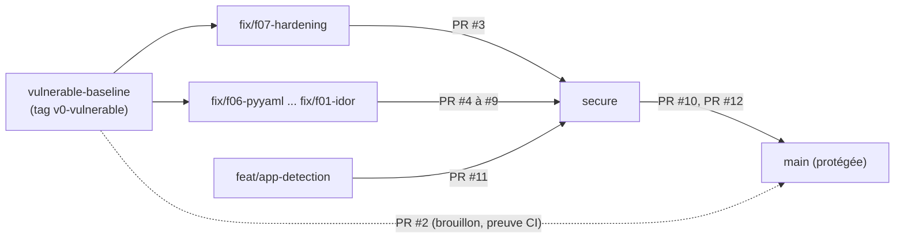
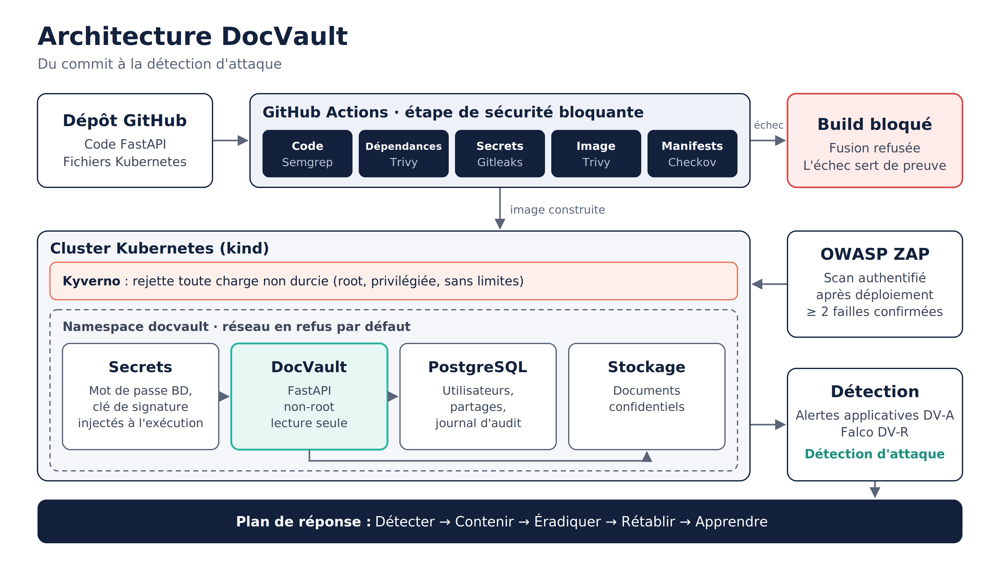

# DocVault : sécuriser une application de documents confidentiels sur tout son cycle de vie

**Rapport final du projet DevSecOps**

> **État du brouillon (2026-11-24).** Tous les chapitres (résumé, tableau de conformité, chapitres 1 à 15, annexes A à C) sont rédigés à partir des documents du dépôt. Restent à compléter par l'équipe, aux endroits marqués **[À compléter]** : la page de garde (date de remise), l'attribution des rôles M1 à M4 (§2.1), l'Annexe A (§2.2), la protection de `secure` (§2.3), les fiches Annexe B (§2.5), la figure d'architecture (§3.1), les captures et la sauvegarde des journaux CI (§6.5, Annexe C), Dependabot (§6.7), les corrections O1 à O3 (§9.9), la décision sur le support GitHub (§10.4), les contrôles de compte et le journal d'audit (§12.4), les exercices P1 et P2 (§12.5), la validation de l'usage de l'IA (§14.4) et la mise à jour du bilan (§15.1). Ce bloc est à retirer avant la remise.

| | |
| --- | --- |
| Établissement | TEK-UP, ING-5-SSIR |
| Enseignant | O. Mansouri |
| Référence | Cahier des charges du projet DevSecOps |
| Équipe | Chaima Khaalsi, Sourour Kraiem, Dhia Medhioub, Rania Khalfet |
| Dépôt | `dhia-03/docvault` sur GitHub (public depuis le 2026-11-22) |
| Version du rapport | Brouillon du 2026-11-24 |
| Date de remise | Voir l'encadré ci-dessous |

> **[À compléter]** Date de remise du rapport (et année universitaire si elle doit figurer sur la page de garde). Le cahier des charges ne contient pas les sections 7 et 8, et la date n'était pas connue au 2026-11-23 ([DEVELOPMENT_PROGRESS.md](../DEVELOPMENT_PROGRESS.md#open-questions)).

---

## Résumé

DocVault est une application web de stockage et de partage de documents confidentiels (FastAPI, PostgreSQL, trois rôles). Nous l'avons construite volontairement vulnérable, avec sept failles (F01 à F07) documentées et exploitées avant toute correction. Nous l'avons ensuite sécurisée à chaque étape du cycle de vie, en conservant une preuve pour chaque résultat.

Ce qui est en place et démontré :

- **Sept failles** couvrant cinq catégories de l'OWASP Top 10:2025, décrites dans le [registre des vulnérabilités](../vulnerability-register.md) et exploitées par un [script](../../scripts/exploits/run_all.py) qui refuse toute cible autre que la machine locale.
- **Une étape CI bloquante** avec les cinq contrôles exigés (Gitleaks, Semgrep, Trivy sur les dépendances, Trivy sur l'image, Checkov), plus un scan ZAP authentifié et une suite pytest. Les seuils sont écrits et justifiés dans la [politique de sécurité](../security-policy.md). La version vulnérable échoue aux cinq contrôles (runs 45065589649 et 45071375296). La version corrigée passe les sept contrôles (run 45106603478 sur `main`).
- **Un conteneur et un déploiement Kubernetes durcis** : utilisateur non root (UID 10001), système de fichiers racine en lecture seule, aucune capacité, pas de jeton de compte de service, réseau en refus par défaut, et quatre politiques Kyverno qui refusent à l'admission un pod non conforme.
- **Un scan ZAP authentifié** après déploiement sur un cluster kind jetable. Sur la version vulnérable, il a levé 4 alertes High qui confirment F02, F03 et F04 (run 45083855384). Sur la version corrigée, il ne lève plus aucune alerte High.
- **La démonstration « révoquer puis purger »** de la clé de signature F05 : révocation, vérification (session forgée refusée, HTTP 303), purge de l'historique, puis vérification dans un clone neuf (0 occurrence, Gitleaks propre).
- **Une détection à l'exécution en deux couches** : quatre alertes applicatives (DV-A1 à DV-A4) et quatre règles Falco (DV-R1 à DV-R4). Chaque règle est déclenchée et vérifiée à chaque run CI.
- **Un plan de réponse aux incidents** avec sept playbooks, des niveaux de sévérité et un modèle de revue post-incident.

Ce qui reste à faire au moment de ce brouillon : les deux exercices du plan de réponse, la correction des faiblesses non planifiées O1 à O3, des contrôles de compte (réinitialisation, désactivation, révocation de session par utilisateur), Dependabot et la protection de la branche `secure`. Ces points sont marqués **[À compléter]** dans le rapport.

Notre principal constat : les outils statiques ne trouvent que 4 failles sur 7. ZAP en trouve deux de plus (F03, F04), et seule la suite de tests trouve F01. Un pipeline vert ne prouve donc pas que l'application est sûre. Le [chapitre 13](#13-réflexion-critique-et-limites) détaille ce que nos contrôles ne prouvent pas.

---

## Tableau de conformité aux exigences

Ce tableau reprend les huit exigences obligatoires (le « socle ») et les exigences administratives du cahier des charges. Chaque ligne renvoie au chapitre qui la démontre et aux preuves vérifiables dans le dépôt ou sur GitHub.

| # | Exigence | Statut | Chapitre | Preuves principales |
| --- | --- | --- | --- | --- |
| 1 | Application volontairement vulnérable, au moins 4 failles documentées avant correction | Fait : 7 failles, toutes exploitées | [§5](#5-application-volontairement-vulnérable) | [vulnerability-register.md](../vulnerability-register.md) ; version d'origine du registre : `git show v0-vulnerable:docs/vulnerability-register.md` (commit `cd2ba33`, 2026-11-22, avant la première correction `62897cb`, 2026-11-23) ; [run_all.py](../../scripts/exploits/run_all.py) : 7 failles sur 7 exploitables |
| 2 | Conteneur durci | Fait | [§7.1](#71-image-du-conteneur) | [backend/Dockerfile](../../backend/Dockerfile) ; scan d'image : 189 vulnérabilités système avant (run 45071375296), 0 après ; processus en UID 10001 ([registre, F07](../vulnerability-register.md#f07-container-runs-as-root)) |
| 3 | Étape CI bloquante, cinq contrôles, seuils justifiés | Fait | [§6](#6-pipeline-ci-bloquant) | [ci.yml](../../.github/workflows/ci.yml), [scan.sh](../../scripts/ci/scan.sh), [security-policy.md](../security-policy.md) ; échecs sur la PR #2 : runs 45065589649 et 45071375296, journaux et captures dans [docs/evidence/](../evidence/) ; succès : runs 45098724265 (PR #10), 45105825605 (PR #12), 45106603478 (`main`) |
| 4 | Gestion des secrets, avec démonstration « révoquer puis purger » | Fait | [§10](#10-gestion-des-secrets-et-démonstration-révoquer-puis-purger) | [f05-revoke-then-purge.md](../f05-revoke-then-purge.md), [purge-leaked-key.sh](../../scripts/security/purge-leaked-key.sh) ; session forgée refusée (HTTP 303) ; clone neuf : 0 occurrence ; Gitleaks réussi sur `main` (run 45106603478) |
| 5 | Déploiement Kubernetes durci, avec contrôle d'admission | Fait (cluster kind) | [§7](#7-conteneur-et-déploiement-kubernetes-durcis) | [deploy/k8s/](../../deploy/k8s/), [deploy/kyverno/](../../deploy/kyverno/pod-security.yaml), [deploy.sh](../../scripts/ci/deploy.sh) ; run 45106603478, job `DAST (ZAP)` : pod refusé par les 4 politiques, base injoignable depuis un autre namespace |
| 6 | Tests dynamiques : DAST authentifié dans le pipeline après déploiement, au moins 2 failles confirmées | Fait : F02, F03, F04 | [§8](#8-tests-dynamiques-dast) | [dast.sh](../../scripts/ci/dast.sh), [plan.yaml](../../scripts/ci/zap/plan.yaml), [zap_gate.py](../../scripts/ci/zap_gate.py) ; rapport du run 45083855384 : [HTML](../evidence/zap-run-45083855384-vulnerable-baseline.html), [JSON](../evidence/zap-run-45083855384-vulnerable-baseline.json) |
| 7 | Détection à l'exécution | Fait : deux couches, démontrées en CI | [§11](#11-détection-à-lexécution) | [runtime-detection.md](../runtime-detection.md), [security_events.py](../../backend/app/security_events.py), [docvault_rules.yaml](../../deploy/falco/docvault_rules.yaml) ; run 45106603478 : DV-A1 à DV-A4 et DV-R1 à DV-R4 détectées |
| 8 | Plan de réponse aux incidents | Rédigé ; exercices non encore réalisés | [§12](#12-plan-de-réponse-aux-incidents) | [incident-response-plan.md](../incident-response-plan.md) ; exercices : **[À compléter]** |
| — | Équipe de 3 à 4 étudiants | 4 étudiants | [§2](#2-équipe-et-organisation) | Page de garde ; [point d'avancement du 18/11](../point-avancement-2026-11-18.md) |
| — | Validation du thème (Annexe A) | Rédigée, validation en attente | [§2.2](#22-validation-du-thème-annexe-a) | **[À compléter]** |
| — | Une fiche de contribution (Annexe B) par personne | À rédiger | [§2.5](#25-fiches-de-contribution-annexe-b) | **[À compléter]** |
| — | Déclaration de tout usage de l'IA | Journal tenu ; validation par l'équipe à compléter | [§14](#14-déclaration-dusage-de-lia) | [ai-usage.md](../ai-usage.md) |

---

## Sommaire

1. [Contexte et objectifs](#1-contexte-et-objectifs)
2. [Équipe et organisation](#2-équipe-et-organisation)
3. [Architecture](#3-architecture)
4. [Modèle de menaces](#4-modèle-de-menaces)
5. [Application volontairement vulnérable](#5-application-volontairement-vulnérable)
6. [Pipeline CI bloquant](#6-pipeline-ci-bloquant)
7. [Conteneur et déploiement Kubernetes durcis](#7-conteneur-et-déploiement-kubernetes-durcis)
8. [Tests dynamiques (DAST)](#8-tests-dynamiques-dast)
9. [Correction des failles](#9-correction-des-failles)
10. [Gestion des secrets et démonstration « révoquer puis purger »](#10-gestion-des-secrets-et-démonstration-révoquer-puis-purger)
11. [Détection à l'exécution](#11-détection-à-lexécution)
12. [Plan de réponse aux incidents](#12-plan-de-réponse-aux-incidents)
13. [Réflexion critique et limites](#13-réflexion-critique-et-limites)
14. [Déclaration d'usage de l'IA](#14-déclaration-dusage-de-lia)
15. [Conclusion et perspectives](#15-conclusion-et-perspectives)
- [Annexe A : glossaire](#annexe-a--glossaire)
- [Annexe B : preuves et runs CI](#annexe-b--preuves-et-runs-ci)
- [Annexe C : captures d'écran à réaliser](#annexe-c--captures-décran-à-réaliser)

---

## 1. Contexte et objectifs

### 1.1 Problème

Dans beaucoup de projets, la sécurité arrive trop tard. Les failles naissent dans le code, les dépendances apportent des vulnérabilités connues, et un déploiement trop permissif transforme une petite faille en compromission complète. L'approche DevSecOps intègre la sécurité à chaque étape : coder, construire, tester, déployer et exploiter.

Notre question centrale est : **comment prouver qu'une application est sûre ?** Concrètement, il faut :

- détecter les failles automatiquement avant la mise en production ;
- empêcher la fusion d'une version non conforme ;
- repérer une attaque pendant l'exécution, et savoir y répondre.

### 1.2 L'application choisie

DocVault stocke et partage des documents confidentiels. Le thème répond au critère de validité du cahier des charges :

| Élément exigé | Dans DocVault |
| --- | --- |
| Backend | FastAPI (Python), pages rendues côté serveur (Jinja2) |
| Base de données | PostgreSQL |
| Authentification à rôles | Administrateur, membre, auditeur |
| Données sensibles | Documents confidentiels, empreintes de mots de passe (Argon2) |

### 1.3 Démarche

Nous avons suivi trois temps :

1. **Casser** : une version volontairement vulnérable, avec sept failles documentées et exploitées avant toute correction (tag `v0-vulnerable`).
2. **Sécuriser** : une correction par faille, chacune dans sa propre pull request, avec un pipeline qui bloque toute fusion non conforme dans `main`.
3. **Prouver** : pour chaque contrôle, une preuve vérifiable (un run CI, un journal, un rapport, une sortie de script), et pour chaque contrôle, ses limites.

### 1.4 Périmètre

Toutes les données sont des données de test. Les versions vulnérables ne tournent qu'en local (`127.0.0.1`) ou sur un runner CI jetable. Le [modèle de menaces](../threat-model.md#out-of-scope) exclut les attaques sur le poste du développeur, sur GitHub lui-même et sur le nœud Kubernetes local, ainsi que les logiciels malveillants contenus dans les documents téléversés (DocVault les stocke sans les ouvrir).

---

## 2. Équipe et organisation

### 2.1 Composition et rôles

L'équipe compte quatre étudiants. Chaque rôle porte une étape du cycle de vie, comme le demande le cahier des charges.

| Rôle | Périmètre | Playbooks dont il est responsable ([plan de réponse](../incident-response-plan.md#2-roles-and-contacts)) |
| --- | --- | --- |
| M1 | Application et sécurité applicative (AppSec) | P3, P4, P5 |
| M2 | CI et secrets | P1, P6 (dépendances), P7 |
| M3 | Conteneur, Kubernetes et DAST | P2, P6 (image) |
| M4 | Observabilité, détection, coordination du rapport | Responsable d'incident par défaut |

> **[À compléter]** Attribution des rôles. Les sources du dépôt ne disent pas quel membre tient quel rôle. Remplir le tableau ci-dessous.

| Membre | Rôle |
| --- | --- |
| Chaima Khaalsi | [À compléter] |
| Sourour Kraiem | [À compléter] |
| Dhia Medhioub | [À compléter] |
| Rania Khalfet | [À compléter] |

### 2.2 Validation du thème (Annexe A)

Le thème DocVault a été proposé le 2026-11-09 et présenté au point d'avancement du 18/11/2026 ([point-avancement-2026-11-18.md](../point-avancement-2026-11-18.md)). Au 2026-11-23, la fiche de réservation (Annexe A) est rédigée mais non soumise, et la validation par l'enseignant est en attente ([DEVELOPMENT_PROGRESS.md](../DEVELOPMENT_PROGRESS.md)). Le brouillon de l'Annexe A n'est pas dans le dépôt.

> **[À compléter]** Statut de l'Annexe A : date de soumission, date et forme de la validation par l'enseignant, et emplacement de la fiche signée (à joindre au rendu).

### 2.3 Flux Git et protection des branches

Le dépôt suit un flux en quatre niveaux. Le code vulnérable et chaque correction restent visibles dans l'historique.



| Branche | Rôle |
| --- | --- |
| `vulnerable-baseline` | Version vulnérable, taguée `v0-vulnerable`. La pull request #2, en brouillon, sert uniquement à conserver les échecs CI comme preuve |
| `fix/fNN-*` | Une branche par faille, fusionnée dans `secure` par une pull request |
| `feat/app-detection` | Détection à l'exécution et plan de réponse (étape 9) |
| `secure` | Intégration des corrections, puis fusion dans `main` par pull request |
| `main` | Branche protégée : n'accepte que des pull requests qui passent les sept contrôles |

**Protection de `main`.** Le dépôt est public depuis le 2026-11-22, car la protection de branche n'est pas disponible sur un dépôt privé avec l'offre gratuite de GitHub. Nous avons relu la configuration le 2026-11-24 avec l'API GitHub (lecture seule) :

| Réglage | Valeur |
| --- | --- |
| Pull request obligatoire | Oui |
| Contrôles requis | `Secret scan (Gitleaks)`, `SAST (Semgrep)`, `Dependency scan (Trivy)`, `Image scan (Trivy)`, `IaC scan (Checkov)`, `DAST (ZAP)`, `Tests (pytest)` |
| Branche à jour avant fusion (`strict`) | Oui |
| S'applique aussi aux administrateurs | Oui |
| Force-push / suppression | Interdits |
| Approbations requises | 0 |

**Protection de `secure`.** Au 2026-11-24, `secure` n'est pas protégée (l'API répond « Branch not protected »). Les pull requests de correction #3 à #9 ont donc pu être fusionnées dans `secure` alors que leurs runs CI étaient en échec. C'était attendu : chaque branche ne corrigeait qu'une faille, les autres restaient présentes. Le passage de `secure` à `main` (#10, #12) a, lui, exigé les sept contrôles au vert.

> **[À compléter]** Protection de la branche `secure` (travail en cours) : réglages appliqués, date, et preuve (capture ou sortie de `gh api repos/{owner}/{repo}/branches/secure/protection`).

### 2.4 Historique des pull requests

Horaires en UTC, d'après `gh pr list` et `gh run list`.

| PR | Branche → base | Objet | Fusion | Run CI (conclusion) |
| --- | --- | --- | --- | --- |
| #1 | `chore/repo-structure-ci` → `main` | Structure du dépôt, CI de sécurité (3 contrôles), documents de conception | 2026-11-09 12:56 | 42619890956 (succès, avant tout code applicatif) |
| #2 | `vulnerable-baseline` → `main` | « [DO NOT MERGE] » version vulnérable, preuve CI | Voir la note ci-dessous | 45065589649, 45071375296, 45083855384 (échec, attendu) |
| #3 | `fix/f07-hardening` → `secure` | F07 : conteneur, déploiement, Kyverno | 2026-11-23 00:51 | 45087523316, 45088306666 (échec, autres failles présentes) |
| #4 | `fix/f06-pyyaml` → `secure` | F06 : PyYAML 6.0.3 et `safe_load` | 2026-11-23 01:18 | 45090429163 (échec) |
| #5 | `fix/f05-signing-key` → `secure` | F05, étape 1 : révocation de la clé | 2026-11-23 01:18 | 45091731572 (échec) |
| #6 | `fix/f02-sql-injection` → `secure` | F02 : requête paramétrée | 2026-11-23 01:47 | 45095711482 (échec) |
| #7 | `fix/f04-path-traversal` → `secure` | F04 : noms aléatoires, aperçu par identifiant | 2026-11-23 01:47 | 45095715221 (échec) |
| #8 | `fix/f03-xss` → `secure` | F03 : échappement, cookie, CSP | 2026-11-23 02:07 | 45097517815 (échec) |
| #9 | `fix/f01-idor` → `secure` | F01 et suite pytest | 2026-11-23 02:07 | 45097520019 (échec : seul Gitleaks, l'historique contenait encore la clé) |
| #10 | `secure` → `main` | Les sept failles corrigées, clé purgée | 2026-11-23 02:19 | 45098724265 (succès, 7 sur 7) ; push sur `main` : 45099516909 (succès) |
| #11 | `feat/app-detection` → `secure` | Étape 9 : détection et plan de réponse | 2026-11-23 03:24 | 45104983793 (succès) |
| #12 | `secure` → `main` | Étape 9 | 2026-11-23 03:32 | 45105825605 (succès) ; push sur `main` : 45106603478 (succès, 7 sur 7) |

**Note sur la PR #2.** La PR #2 n'a jamais été fusionnée à la main : elle est restée en brouillon, et un brouillon ne peut pas être fusionné. GitHub l'affiche pourtant « Merged » depuis le 2026-11-23 à 02:19:12, une seconde après la fusion de la PR #10. La branche `secure` part de `vulnerable-baseline`, donc le dernier commit de la PR #2 (`65c59a1`) est devenu un ancêtre de `main` à ce moment, et GitHub a marqué la PR comme fusionnée. Les échecs CI de la PR #2 restent consultables, et leurs journaux sont sauvegardés dans [docs/evidence/](../evidence/).

### 2.5 Fiches de contribution (Annexe B)

Le cahier des charges exige une fiche de contribution par personne. Ce rapport ne décrit pas la contribution individuelle de chaque membre.

> **[À compléter]** Quatre fiches Annexe B, une par membre, signées, avec pour chacun : rôle, travaux réalisés, pull requests ou fichiers concernés, et part des travaux faits avec l'IA (en cohérence avec [ai-usage.md](../ai-usage.md)).

---

## 3. Architecture

### 3.1 Vue d'ensemble



*Figure 1. Architecture cible présentée au point d'avancement du 18/11/2026 ([source SVG](../diagrams/architecture.svg)).*

Cette figure montre l'architecture **cible** du 18/11. La réalisation diffère sur quatre points :

| Sur la figure | Dans la réalisation | Raison ou référence |
| --- | --- | --- |
| Cluster Kubernetes « Minikube » | Cluster **kind** jetable, créé par [deploy.sh](../../scripts/ci/deploy.sh) en local et sur le runner CI | Le même script tourne en local et en CI ; Minikube n'est plus nécessaire ([DEVELOPMENT_PROGRESS.md](../DEVELOPMENT_PROGRESS.md#known-limitations)) |
| Observabilité « Prometheus, Loki, Grafana » | Événements et alertes en lignes JSON sur la sortie standard de l'application, et **Falco** pour les conteneurs | [runtime-detection.md](../runtime-detection.md). Aucune collecte centrale n'est en place (voir [§13](#13-réflexion-critique-et-limites)) |
| Flèche « image approuvée » de l'étape bloquante vers le cluster | Le job de déploiement et de DAST **n'attend pas** les contrôles statiques. La fusion dans `main` exige, elle, tous les contrôles | Permet de scanner dynamiquement la version vulnérable ; voir [§6.6](#66-choix-le-job-de-déploiement-nattend-pas-les-contrôles-statiques) |
| « Build bloqué, rien n'est déployé » | Rien n'est **fusionné** dans `main`. Aucune image n'est poussée vers un registre : le déploiement n'existe que sur le runner jetable | [ci.yml](../../.github/workflows/ci.yml) |

> **[À compléter]** Décision de l'équipe : mettre à jour la figure (kind, Falco, pas de Grafana, déploiement non conditionné) ou la garder comme architecture cible avec le tableau ci-dessus.

### 3.2 Composants

| Composant | Réalisation | Fichiers |
| --- | --- | --- |
| Application | FastAPI et uvicorn, pages Jinja2, SQLAlchemy et Alembic, mots de passe hachés avec Argon2, session dans un cookie signé (`docvault_session`, durée 8 heures) | [backend/app/](../../backend/app/) |
| Base de données | PostgreSQL en StatefulSet, image épinglée par empreinte (digest) | [10-db.yaml](../../deploy/k8s/10-db.yaml) |
| Stockage des documents | Volume persistant de 1 Gi monté sur `/data/documents` | [20-app.yaml](../../deploy/k8s/20-app.yaml) |
| Secrets | Secret Kubernetes `docvault-secrets`, monté en fichiers, chaque conteneur ne recevant que ce qu'il utilise | [20-app.yaml](../../deploy/k8s/20-app.yaml), [config.py](../../backend/app/config.py) |
| Contrôle d'admission | Kyverno v1.19.2, quatre `ClusterPolicy` en mode `Enforce` | [pod-security.yaml](../../deploy/kyverno/pod-security.yaml) |
| Segmentation réseau | Quatre NetworkPolicies : refus par défaut, DNS, application, base | [30-network-policies.yaml](../../deploy/k8s/30-network-policies.yaml) |
| Détection | Alertes applicatives DV-A1 à DV-A4 ; Falco 0.45.2 (sonde eBPF moderne) avec les règles DV-R1 à DV-R4 | [security_events.py](../../backend/app/security_events.py), [deploy/falco/](../../deploy/falco/) |
| Accès de test | Node port 30080 exposé uniquement sur `127.0.0.1:18000` | [deploy/test/access.yaml](../../deploy/test/access.yaml) |
| CI | GitHub Actions, sept jobs, outils épinglés | [ci.yml](../../.github/workflows/ci.yml), [scripts/ci/](../../scripts/ci/) |

### 3.3 Environnements

Il n'existe pas de serveur de production. Tous les environnements sont des environnements de test ([plan de réponse, §1](../incident-response-plan.md#environments-covered)).

| Environnement | Où | Secrets |
| --- | --- | --- |
| Docker Compose | Machine de chaque membre, écoute sur `127.0.0.1` uniquement | Fichier `.env` local, jamais commité (modèle : [.env.example](../../.env.example)) |
| Cluster kind `docvault` | Machine de chaque membre, `http://127.0.0.1:18000` | Secret `docvault-secrets`, créé par `deploy.sh` à partir de l'environnement |
| Runners CI | GitHub Actions, supprimés après chaque run | Valeurs aléatoires générées à chaque run et masquées ; aucun secret Actions stocké |

---

## 4. Modèle de menaces

Source : [threat-model.md](../threat-model.md). La méthode est STRIDE, avec une correspondance vers l'OWASP Top 10:2025. Les niveaux de risque sont des jugements qualitatifs, pas des mesures. Le modèle a été rédigé le 2026-11-09, avant le code ; les emplacements exacts des failles ont été ajoutés dans le registre au moment de leur création.

### 4.1 Actifs et frontières de confiance

| ID | Actif | Pourquoi il compte |
| --- | --- | --- |
| AS1 | Documents téléversés | Les données confidentielles que DocVault protège |
| AS2 | Empreintes de mots de passe et sessions | Permettent d'usurper un utilisateur |
| AS3 | Mot de passe de la base et clé de signature des sessions | Donnent accès à toutes les données ou permettent de forger des sessions |
| AS4 | Rôles et partages | Décident qui peut lire quoi |
| AS5 | Journal d'audit | Preuve pour enquêter sur un incident |
| AS6 | Dépôt, pipeline CI et images | Une compromission ici atteint la production |

| ID | Frontière | Règle |
| --- | --- | --- |
| TB1 | Navigateur → application | Toute entrée utilisateur est non fiable |
| TB2 | Application → base | Aucune requête construite à partir d'une entrée brute |
| TB3 | Application → stockage | Les noms et chemins de fichiers ne viennent pas de l'utilisateur |
| TB4 | CI → image et cluster | Seules les images qui passent l'étape de sécurité sont déployées |
| TB5 | Charge de travail → Kubernetes | Un pod compromis n'atteint ni les autres pods ni l'API Kubernetes |

### 4.2 Analyse STRIDE

Dix-huit menaces sont identifiées : 12 de risque élevé, 5 moyen, 1 faible. La divulgation d'information est la catégorie la plus représentée, ce qui est cohérent pour une application de documents confidentiels.

| Catégorie | Nombre | Menaces |
| --- | --- | --- |
| Usurpation (Spoofing) | 3 | T01 à T03 |
| Altération (Tampering) | 4 | T04 à T07 |
| Répudiation | 1 | T08 |
| Divulgation d'information | 5 | T09 à T13 |
| Déni de service | 2 | T14, T15 |
| Élévation de privilèges | 3 | T16 à T18 |

| ID | Élément | Menace | Risque | Contrôle | Faille |
| --- | --- | --- | --- | --- | --- |
| T01 | Connexion | Devinette de mot de passe, credential stuffing | Moyen | Hachage fort, journalisation des échecs, alerte DV-A1 ; limitation des tentatives pas encore en place (O2) | |
| T02 | Session | Vol du cookie de session par injection de script | Élevé | Cookies `HttpOnly`, `Secure`, `SameSite` ; encodage des sorties | F03 |
| T03 | Session | Clé de signature dans le code : sessions forgées | Élevé | Clé fournie à l'exécution, rotation après exposition | F05 |
| T04 | Base | Injection SQL qui modifie des données ou des partages | Élevé | Requêtes paramétrées | F02 |
| T05 | Stockage | Nom de fichier forgé qui écrit hors du dossier | Élevé | Noms générés par le serveur, contrôle des chemins | F04 |
| T06 | Dépendances, image | Composant tiers vulnérable ou compromis | Élevé | Versions épinglées, scans des dépendances et de l'image | F06 |
| T07 | Pipeline CI | Workflow détourné pour modifier un build | Moyen | Jeton en lecture seule, actions et images épinglées par empreinte | |
| T08 | Partage, suppression | Un utilisateur nie avoir partagé ou supprimé | Moyen | Journal d'audit (utilisateur, action, heure) ; l'identifiant de corrélation prévu n'est pas encore en place | |
| T09 | Téléchargement | Changer l'identifiant d'un document ouvre celui d'autrui | Élevé | Contrôle de propriété ou de partage à chaque requête | F01 |
| T10 | Recherche | Injection SQL qui extrait documents ou empreintes | Élevé | Requêtes paramétrées, compte de base limité | F02 |
| T11 | Stockage | Traversée de répertoire qui lit hors du dossier | Élevé | Fichiers retrouvés par identifiant, jamais par un chemin fourni | F04 |
| T12 | Dépôt, image | Secret commité ou intégré à l'image | Élevé | Secrets à l'exécution, détection de secrets, procédure « révoquer puis purger » | F05 |
| T13 | Journaux | Mots de passe, jetons ou contenus écrits dans les journaux | Moyen | Journaux structurés avec une liste de champs autorisés, testée | |
| T14 | Téléversement | Fichiers très volumineux ou répétés qui remplissent le stockage | Moyen | Limite de taille, quota, limites de ressources (O3 ouvert) | |
| T15 | Recherche, connexion | Requêtes coûteuses qui épuisent l'application | Faible | Limitation de débit, limites CPU et mémoire | |
| T16 | Pages admin | Un membre atteint les fonctions d'administration | Élevé | Contrôle de rôle côté serveur sur chaque route admin | |
| T17 | Conteneur | Conteneur root ou privilégié qui facilite une évasion | Élevé | Non-root, racine en lecture seule, capacités retirées | F07 |
| T18 | Cluster | Pod compromis qui atteint d'autres charges ou l'API | Élevé | Pas de jeton de compte de service, moindre privilège, réseau en refus par défaut, admission | F07 |

### 4.3 Couverture de l'OWASP Top 10:2025

| Catégorie | Où elle est traitée | Couverture |
| --- | --- | --- |
| A01 Broken Access Control | F01, F04, T16 | Failles plantées, tests à deux utilisateurs |
| A02 Security Misconfiguration | F07, T18 | Faille plantée, Checkov, Kyverno |
| A03 Software Supply Chain Failures | F06, T06, T07 | Faille plantée et scans ; les scanners ne trouvent que les problèmes connus |
| A04 Cryptographic Failures | T01, T02 | Hachage standard, cookies réservés à HTTPS par défaut ; pas de faille plantée |
| A05 Injection | F02, F03 | Failles plantées, Semgrep, ZAP |
| A06 Insecure Design | Ce modèle, T14 | Revue de conception uniquement ; aucun outil ne le prouve |
| A07 Authentication Failures | F05, T01, T03 | Faille plantée, contrôles de connexion |
| A08 Software or Data Integrity Failures | T06, T07 | Images et actions épinglées ; la signature d'images n'est pas prévue |
| A09 Security Logging and Alerting Failures | T08, T13 | Événements structurés, alertes DV-A1 à DV-A4, règles Falco DV-R1 à DV-R4, démontrées en CI |
| A10 Mishandling of Exceptional Conditions | T14, T15 | Tests de gestion d'erreurs ; pas de faille plantée |

Les sept failles couvrent cinq catégories (A01, A02, A03, A05, A07). Les autres sont traitées par la conception ou documentées comme non couvertes.

---

## 5. Application volontairement vulnérable

### 5.1 Fonctionnalités et rôles

DocVault propose la connexion, le téléversement, la recherche, la consultation, l'aperçu, le téléchargement, le partage, l'édition de métadonnées (en YAML), la suppression, l'administration des utilisateurs et un journal d'audit.

| Rôle | Peut | Ne peut pas |
| --- | --- | --- |
| Administrateur | Gérer les utilisateurs et les rôles, lire le journal d'audit | Lire les documents des autres sans partage |
| Membre | Téléverser, chercher, télécharger ses documents, les partager avec d'autres membres | Atteindre les pages d'administration ou des documents non partagés |
| Auditeur | Lire le journal d'audit | Lire le contenu des documents ou modifier quoi que ce soit |

Les comptes de démonstration sont `admin`, `alice`, `bob` et `auditor`. Les contrôles de rôle ont été vérifiés le 2026-11-09 : un membre ou un auditeur reçoit HTTP 403 sur `/admin/users`, un membre reçoit 403 sur `/audit` ([tests exécutés](../DEVELOPMENT_PROGRESS.md#tests-executed)).

### 5.2 Les sept failles

Le cahier des charges demande au moins quatre failles. Nous en avons planté sept. Le détail (emplacement, cause, impact, preuve) est dans le [registre des vulnérabilités](../vulnerability-register.md). Les emplacements sont ceux de la version vulnérable (tag `v0-vulnerable`).

| ID | Faille | Emplacement | OWASP 2025 | CWE | Preuve d'exploitation | Détectée par |
| --- | --- | --- | --- | --- | --- | --- |
| F01 | Accès à n'importe quel document par son identifiant | `main.py` l. 206-212, `download_document` | A01 | CWE-639 | Bob télécharge un document privé d'Alice : HTTP 200 avec son contenu | Aucun scanner ; suite pytest |
| F02 | Injection SQL dans la recherche | `main.py` l. 152-159, `list_documents` | A05 | CWE-89 | Un `UNION SELECT` dans la recherche renvoie noms d'utilisateur et empreintes Argon2 | Semgrep, ZAP |
| F03 | Injection de script (XSS) réfléchie et stockée | `documents.html` l. 12 et 20, `document.html` l. 5, cookie sans `HttpOnly` (`main.py` l. 127-134) | A05 | CWE-79 | Un `<script>` (terme de recherche) et un `` (titre stocké) apparaissent sans encodage | ZAP (réfléchie et DOM) ; Semgrep l'a manquée |
| F04 | Traversée de répertoire | `main.py` l. 170-173 (téléversement), 219-224 (aperçu) | A01 | CWE-22 | `/preview?file=../../etc/passwd` renvoie le fichier ; un fichier `../escaped-*.txt` est écrit hors du stockage | ZAP ; Semgrep l'a manquée |
| F05 | Clé de signature des sessions écrite dans le code (valeur de test) | `config.py` l. 9 | A07 | CWE-798 | Un cookie signé avec cette clé pour l'utilisateur 1 ouvre `/admin/users` (HTTP 200) | Gitleaks |
| F06 | Dépendance vulnérable : PyYAML 5.3 (CVE-2020-14343, CVE-2020-1747) avec `FullLoader` | `requirements.in` l. 11, `main.py` l. 259-260 | A03 | CWE-1395 | Une charge inoffensive dans le formulaire de métadonnées exécute `os.getuid()` et affiche le résultat | Trivy (dépendances et image) |
| F07 | Conteneur exécuté en root, déploiement sans restriction | `Dockerfile` l. 2, `20-app.yaml`, `10-db.yaml` | A02 | CWE-250 | UID 0 renvoyé via F06 ; `id -u` dans le pod : 0 ; jeton de compte de service présent | Semgrep (`missing-user`), Checkov |

### 5.3 Documentation avant correction

Le cahier des charges exige que les failles soient documentées avant d'être corrigées. L'historique Git le montre :

| Étape | Commit | Date (heure locale) |
| --- | --- | --- |
| Version vulnérable et registre des sept failles, toutes « Open » | `cd2ba33` (tag `v0-vulnerable`) | 2026-11-22 21:16 +01:00 |
| Première correction (F07) | `62897cb` | 2026-11-23 01:13 +01:00 |

Pour vérifier : `git show v0-vulnerable:docs/vulnerability-register.md` affiche le registre d'origine, avec pour chaque faille l'emplacement, la cause, l'impact, la preuve et le correctif prévu, et le statut « Open ».

Le registre indique que les failles ont été exploitées en local dès le 2026-11-09. Le code a été commité plus tard, le 2026-11-22. Les identifiants de commit ont changé lors de la purge de F05 (voir [§10](#10-gestion-des-secrets-et-démonstration-révoquer-puis-purger)) : le registre cite `3e82f9a`, l'identifiant d'origine, qui correspond aujourd'hui à `cd2ba33`.

### 5.4 Script d'exploitation et garde-fou

[`scripts/exploits/run_all.py`](../../scripts/exploits/run_all.py) teste chaque faille contre une instance locale et affiche `VULNERABLE`, `not exploitable` ou `not tested`. Il sert à produire une preuve avant et après chaque correction. Il n'utilise que des identifiants de test.

Le cahier des charges n'autorise que les tests sur notre propre application. Le script refuse donc toute autre cible :

```python
if urlparse(args.base_url).hostname not in ("127.0.0.1", "localhost"):
    sys.exit("Refusing to run: the target must be this machine.")
```

Ce refus a été vérifié le 2026-11-09 ([tests exécutés](../DEVELOPMENT_PROGRESS.md#tests-executed)).

| Date | Cible | Résultat |
| --- | --- | --- |
| 2026-11-09 | Docker Compose, version vulnérable | 7 failles sur 7 exploitables |
| 2026-11-22 | Cluster k3s jetable, manifests d'origine | 7 sur 7 exploitables ; pod applicatif en UID 0 |
| 2026-11-23 | Déploiement durci (kind) et Compose, après F07 | 6 sur 7 ; F07 non exploitable (UID 10001) |
| 2026-11-23 | Compose, après les sept corrections | 0 sur 6 failles testées ; F07 « not tested » car mesurée via F06, vérifiée directement avec `id -u` (10001) |

### 5.5 Faiblesses non planifiées

Pendant la construction et les tests, nous avons trouvé cinq faiblesses réelles qui n'étaient pas plantées ([registre](../vulnerability-register.md#unplanned-weaknesses)).

| ID | Faiblesse | Trouvée par | État |
| --- | --- | --- | --- |
| O1 | Formulaires sans jeton CSRF ; seule protection : `SameSite=Lax` | Règles `WARNING` de Semgrep (8 formulaires), alerte ZAP `Medium` | Ouverte, voir [§9.9](#99-faiblesses-non-planifiées-o1-à-o3) |
| O2 | Pas de limitation des tentatives de connexion (T01) | Revue de conception | Ouverte |
| O3 | Pas de limite de taille de téléversement ni de quota (T14) | Revue de conception | Ouverte |
| O4 | Image de base `python:3.12` : 189 vulnérabilités système HIGH ou CRITICAL corrigeables (13 critiques) | Scan d'image Trivy, 2026-11-22 | Corrigée avec F07 : 0 restante |
| O5 | Manifests sans limites, sondes, politiques réseau ni empreintes ; l'application n'attend pas la base | Checkov et déploiement k3s | Corrigée avec F07 |

---

## 6. Pipeline CI bloquant

### 6.1 Vue d'ensemble

Le workflow [ci.yml](../../.github/workflows/ci.yml) tourne à chaque push sur `main` et à chaque pull request. Les contrôles statiques appellent le même script, [scan.sh](../../scripts/ci/scan.sh), qu'en local (`bash scripts/ci/scan.sh all`), donc les résultats sont identiques.

| Job (nom du contrôle requis) | Ce qu'il fait |
| --- | --- |
| `Secret scan (Gitleaks)` | Cherche des secrets dans l'arborescence et dans tout l'historique Git (`fetch-depth: 0`), avec caviardage (`--redact`) |
| `SAST (Semgrep)` | Analyse statique du code avec les jeux de règles `p/default` et `p/owasp-top-ten` |
| `Dependency scan (Trivy)` | Vulnérabilités des dépendances déclarées |
| `Image scan (Trivy)` | Construit l'image applicative et la scanne, y compris les paquets du système |
| `IaC scan (Checkov)` | Dockerfile et manifests Kubernetes |
| `Tests (pytest)` | Tests de non-régression des failles et de la détection, sur SQLite |
| `DAST (ZAP)` | Déploie sur kind, lance la démonstration de détection applicative, le scan ZAP authentifié puis la démonstration Falco |

Les cinq premiers sont les cinq contrôles exigés par le cahier des charges. Les sept sont requis pour fusionner dans `main`.

### 6.2 Seuils et justification

Source : [security-policy.md](../security-policy.md). Le principe : le build échoue sur tout secret exposé et sur tout problème à fort impact que nous pouvons réellement corriger.

| Contrôle | Le build échoue sur | Justification |
| --- | --- | --- |
| Gitleaks | Toute détection, dans l'arborescence ou l'historique | Une seule clé valide suffit à une compromission ; les niveaux de sévérité ne s'appliquent pas |
| Semgrep | Toute détection de sévérité `ERROR` | Ces règles visent des classes directement exploitables comme l'injection. Les sévérités inférieures produisent plus de faux positifs, et bloquer dessus pousserait à des exceptions en bloc |
| Trivy (dépendances) | `HIGH` ou `CRITICAL` avec un correctif disponible | Ces vulnérabilités peuvent mener à une compromission à distance, et une mise à jour existe. Bloquer sur un problème sans correctif arrêterait la livraison sans action possible |
| Trivy (image) | `HIGH` ou `CRITICAL` avec un correctif disponible | Même raisonnement ; couvre en plus les paquets du système, invisibles pour le scan des dépendances |
| Checkov | Tout contrôle en échec | Ces fichiers sont à nous et petits ; chaque échec se corrige par un changement de configuration |
| ZAP | Toute alerte de risque `High` | Comportement exploitable sur l'application en marche. Les alertes `Medium` sont souvent des en-têtes manquants : elles sont suivies, pas bloquantes |
| Détection (même job que ZAP) | Une alerte DV-A1 à DV-A4 ou une règle DV-R1 à DV-R3 qui ne se déclenche pas pendant sa démonstration ; ou une alerte DocVault pendant un déploiement normal | Une détection qui cesse de fonctionner donne une fausse confiance, et une règle bruyante finit ignorée. DV-R4 est rapportée mais pas exigée |

**Exceptions.** Une exception n'est admise que si sont consignés : la détection, la raison, un contrôle compensatoire, un responsable et une date d'expiration. Aucune exception n'est possible pour un vrai secret ou pour une vulnérabilité critique corrigeable. Les durées maximales (7 jours pour un critique sans correctif, 14 jours pour un `HIGH`, 30 jours pour une alerte ZAP `Medium`) sont des jugements adaptés à un projet court, pas une référence externe. Aucune exception ne doit rester ouverte au rendu final. Les deux exceptions en cours, E1 et E2, sont décrites au [§7.6](#76-exceptions-checkov-e1-et-e2).

**Version vulnérable.** La politique précise que la version vulnérable doit échouer, que ces échecs sont conservés comme preuve, et qu'aucune exception n'est utilisée pour la faire passer.

### 6.3 Épinglage des outils et durcissement du pipeline

| Élément | Version épinglée |
| --- | --- |
| Gitleaks | `zricethezav/gitleaks:v8.30.1`, par empreinte `sha256` |
| Semgrep | `semgrep/semgrep:1.182.0`, par empreinte |
| Trivy | `aquasec/trivy:0.76.1`, par empreinte |
| Checkov | `bridgecrew/checkov:3.4.3`, par empreinte |
| OWASP ZAP | `zaproxy/zap-stable:2.17.0`, par empreinte |
| Actions GitHub | `actions/checkout` v7.0.1, `actions/setup-python` v7.1.0, `actions/upload-artifact` v7.0.1, chacune par SHA complet de commit |
| kind, kubectl, Helm, chart Falco, manifest Kyverno | Version fixe et somme SHA-256 vérifiée au téléchargement ([deploy.sh](../../scripts/ci/deploy.sh)) |

Autres mesures :

- Le workflow n'a que la permission `contents: read`, et `actions/checkout` ne conserve pas les identifiants (`persist-credentials: false`).
- Les scanners tournent sans privilèges : utilisateur courant, `--cap-drop ALL`, `no-new-privileges`, dépôt monté en lecture seule. Gitleaks et Checkov tournent sans réseau.
- Le scan d'image travaille sur une copie exportée (`docker save`) : le scanner ne reçoit jamais le socket Docker, qui donnerait le contrôle de l'hôte.
- Le dépôt n'a aucun secret GitHub Actions. Les mots de passe de test et la clé de signature sont générés à chaque run (`openssl rand`) et masqués dans les journaux.

### 6.4 Preuve du blocage

La version vulnérable a été poussée sur la pull request #2 (brouillon, jamais destinée à être fusionnée).

| Run | Date | Contrôles | Résultat | Preuve |
| --- | --- | --- | --- | --- |
| 45065589649 | 2026-11-22 | 3 (Gitleaks, Semgrep, Trivy) | Les 3 en échec | [Journal](../evidence/ci-run-45065589649-vulnerable-baseline.log), [capture du run](../evidence/ci-run-45065589649-summary.png), [capture de la PR](../evidence/pr-2-merge-box-draft.png) |
| 45071375296 | 2026-11-22 | 5 | Les 5 en échec | [Journal](../evidence/ci-run-45071375296-five-checks.log), [capture « 5 failing checks, Required »](../evidence/pr-2-five-required-checks.png) |
| 45083855384 | 2026-11-22 23:33 UTC | 6 (avec ZAP) | Les 6 en échec ; ZAP : 4 alertes High | [Rapport ZAP HTML](../evidence/zap-run-45083855384-vulnerable-baseline.html), [JSON](../evidence/zap-run-45083855384-vulnerable-baseline.json) |

Détail du run 45071375296, lu dans le journal sauvegardé :

| Contrôle | Détections | Faille |
| --- | --- | --- |
| Gitleaks | 1 secret : règle `generic-api-key`, `backend/app/config.py` ligne 9, valeur caviardée (`REDACTED`) | F05 |
| Semgrep | 2 détections bloquantes : `missing-user` sur le Dockerfile, `avoid-sqlalchemy-text` sur la recherche | F07, F02 |
| Trivy (dépendances) | 2 `CRITICAL` dans `pyyaml` 5.3 : CVE-2020-14343 (et CVE-2020-1747) | F06 |
| Trivy (image) | 189 vulnérabilités système (176 `HIGH`, 13 `CRITICAL`), plus les 2 de PyYAML | O4, F06 |
| Checkov | Dockerfile : 2 échecs (`CKV_DOCKER_3` utilisateur, `CKV_DOCKER_2` HEALTHCHECK) ; manifests : 39 échecs | F07, O5 |

Ces résultats sont identiques à ceux obtenus en local le 2026-11-09 et le 2026-11-22 ([tests exécutés](../DEVELOPMENT_PROGRESS.md#tests-executed)).

La capture [pr-2-five-required-checks.png](../evidence/pr-2-five-required-checks.png) montre les cinq contrôles en échec, chacun marqué « Required » par la protection de `main`.

### 6.5 Preuve du passage

| Run | Événement | Résultat |
| --- | --- | --- |
| 45098724265 | PR #10 (`secure` → `main`) | Les 7 contrôles réussis |
| 45099516909 | Push sur `main` après la PR #10 | Réussi |
| 45105825605 | PR #12 (`secure` → `main`) | Les 7 contrôles réussis |
| 45106603478 | Push sur `main` après la PR #12 | Les 7 contrôles réussis ; `Tests (pytest)` : « 47 passed » |

> **[À compléter]** Captures des PR #10 et #12 avec les sept contrôles au vert, à placer à côté de la capture de la PR #2 (voir [Annexe C](#annexe-c--captures-décran-à-réaliser)). Sauvegarder aussi dans `docs/evidence/` les journaux du run 45106603478 et ses artefacts `zap-report` et `falco-alerts` : GitHub ne les conserve que pendant une durée limitée (90 jours pour les artefacts, d'après `retention-days` dans [ci.yml](../../.github/workflows/ci.yml)).

### 6.6 Choix : le job de déploiement n'attend pas les contrôles statiques

Le job `DAST (ZAP)` démarre en parallèle des contrôles statiques, sans les attendre. C'est un choix délibéré, expliqué dans [ci.yml](../../.github/workflows/ci.yml) :

- Si le déploiement attendait les contrôles statiques, la version vulnérable ne serait jamais déployée, et ZAP ne pourrait jamais confirmer F02, F03 et F04. Or le cahier des charges exige des failles confirmées par le DAST.
- L'environnement est un cluster kind sur le runner, isolé et supprimé avec lui. Aucune image n'est poussée vers un registre.
- La fusion dans `main` exige toujours les sept contrôles.

La conséquence est que « rien n'est déployé en cas d'échec », formule de notre présentation du 18/11, n'est vraie que pour `main`, pas pour l'environnement de test du runner.

### 6.7 Alertes de dépendances (Dependabot)

Au 2026-11-23, les alertes Dependabot sont désactivées et la CI n'a pas d'exécution planifiée : une nouvelle vulnérabilité n'est donc détectée qu'au prochain push ou à la prochaine pull request ([plan de réponse, P6](../incident-response-plan.md#p6-vulnerable-dependency-or-image-disclosed)). La détection de secrets de GitHub (secret scanning) a été activée le 2026-11-23.

> **[À compléter]** Activation de Dependabot (travail en cours) : alertes et/ou mises à jour automatiques, écosystèmes couverts (pip, Docker, GitHub Actions), date, et preuve (fichier `.github/dependabot.yml` s'il est ajouté, capture des réglages).

---

## 7. Conteneur et déploiement Kubernetes durcis

Ce chapitre correspond à la correction de F07 (pull request #3) et aux exigences 2 et 5.

### 7.1 Image du conteneur

| Aspect | Version vulnérable | Version durcie ([Dockerfile](../../backend/Dockerfile)) |
| --- | --- | --- |
| Image de base | `python:3.12` complète, une seule étape | `python:3.12-slim-trixie`, épinglée par empreinte, en deux étapes (construction, exécution) |
| Mises à jour | Aucune | Mises à jour de sécurité Debian appliquées à la construction |
| Utilisateur | root (UID 0) | Utilisateur dédié, UID et GID 10001, sans shell de connexion |
| Code | Modifiable par le processus | Appartient à root : l'application ne peut pas se modifier |
| Santé | Aucune | `HEALTHCHECK` sur `/healthz` |
| Taille | 1,19 Go | 230 Mo |
| Vulnérabilités système (Trivy) | 189 `HIGH`/`CRITICAL` corrigeables | 0 |

### 7.2 Contexte de sécurité des pods

Les deux charges de travail ([20-app.yaml](../../deploy/k8s/20-app.yaml), [10-db.yaml](../../deploy/k8s/10-db.yaml)) appliquent les mêmes règles :

| Réglage | Valeur | Effet |
| --- | --- | --- |
| `runAsNonRoot`, `runAsUser` | `true`, 10001 | Pas de processus root |
| `allowPrivilegeEscalation` | `false` | Pas d'élévation via setuid |
| `capabilities.drop` | `ALL` | Aucune capacité Linux |
| `seccompProfile` | `RuntimeDefault` | Appels système filtrés |
| `readOnlyRootFilesystem` | `true` | Seuls `/tmp` (emptyDir) et `/data/documents` sont modifiables |
| `automountServiceAccountToken` | `false` | Aucun jeton pour l'API Kubernetes |
| `resources.limits` | CPU et mémoire | Un conteneur ne peut pas affamer les autres |
| Sondes | readiness et liveness sur `/healthz` | Le pod n'est prêt que quand l'application répond |
| Conteneur d'initialisation `prepare` | Attend la base, applique les migrations, crée les comptes | L'application ne redémarre plus en boucle |

### 7.3 Secrets dans Kubernetes

Les mots de passe et la clé de signature sont montés **en fichiers**, pas en variables d'environnement, qui fuient plus facilement (rapports d'erreur, processus enfants). Chaque conteneur ne reçoit que ce qu'il utilise : l'application reçoit le mot de passe de la base et la clé de signature, mais pas le mot de passe initial des comptes ; le conteneur `prepare` reçoit le mot de passe de la base et le mot de passe initial, mais pas la clé. Les fichiers ont le mode `0440`.

### 7.4 Segmentation réseau

[30-network-policies.yaml](../../deploy/k8s/30-network-policies.yaml) applique un refus par défaut dans le namespace `docvault` :

| Politique | Effet |
| --- | --- |
| `default-deny` | Tout le trafic entrant et sortant est refusé |
| `allow-dns` | Sortie vers le DNS du cluster (port 53) |
| `app` | Entrée sur le port 8000 ; sortie uniquement vers la base, port 5432 |
| `db` | Entrée uniquement depuis l'application, port 5432 |

Aucun pod du namespace ne peut joindre Internet.

### 7.5 Contrôle d'admission avec Kyverno

Quatre politiques ([pod-security.yaml](../../deploy/kyverno/pod-security.yaml)) refusent à l'admission tout pod qui tournerait comme la version vulnérable. Kyverno les applique aussi aux Deployments et StatefulSets, donc une charge non conforme est refusée dès son application.

| Politique | Exige |
| --- | --- |
| `pod-security-restricted` | Le niveau `restricted` des Pod Security Standards de Kubernetes : non-root, pas d'élévation, capacités retirées, seccomp, types de volumes sûrs |
| `require-read-only-root-filesystem` | Racine en lecture seule pour chaque conteneur, y compris d'initialisation |
| `require-resource-limits` | Limites CPU et mémoire pour chaque conteneur |
| `disallow-service-account-token` | `automountServiceAccountToken: false` |

Les namespaces système (`kube-system`, `kyverno`, `local-path-storage`) et `falco` sont exclus. Falco est un agent de sécurité au niveau du nœud : il doit tourner privilégié, en root, avec des chemins de l'hôte montés, ce que ces politiques refusent à juste titre pour une charge applicative. Rien d'autre ne tourne dans ce namespace.

**Preuve.** À chaque déploiement, [deploy.sh](../../scripts/ci/deploy.sh) vérifie que les contrôles fonctionnent, et s'arrête au premier échec :

1. Il tente de créer un pod sans contexte de sécurité (`kubectl run kyverno-check --dry-run=server`). Le pod doit être refusé **par le webhook Kyverno**, et le script affiche chaque politique qui l'a refusé.
2. Il lance un pod sonde (`pg_isready`) dans un autre namespace. La base ne doit pas répondre.
3. Il vérifie que `/healthz` répond et qu'`alice` peut se connecter.
4. Il vérifie que Falco n'a levé aucune alerte DocVault pendant tout le déploiement.

Extrait du job `DAST (ZAP)` du run 45106603478 sur `main` (2026-11-23) :

```text
    rejected by policy: disallow-service-account-token
    rejected by policy: pod-security-restricted
    rejected by policy: require-read-only-root-filesystem
    rejected by policy: require-resource-limits
    blocked: db.docvault.svc.cluster.local:5432 - no response
    /healthz answered ok
    test user 'alice' signed in
    no DV-R alert since 2026-11-23T03:34:37Z
```

Le même résultat a été obtenu en local sur un cluster kind neuf le 2026-11-23 ([tests exécutés](../DEVELOPMENT_PROGRESS.md#tests-executed)). À l'inverse, les manifests d'origine déployés sur un cluster k3s jetable le 2026-11-22 donnaient un pod en UID 0, avec le jeton de compte de service présent, et 7 failles sur 7 exploitables.

### 7.6 Exceptions Checkov E1 et E2

Après le durcissement, Checkov ne signale plus aucun échec, avec deux exceptions consignées dans le [registre des exceptions](../security-policy.md#exception-register). Les deux viennent de l'absence de registre d'images.

| ID | Contrôle | Raison | Contrôle compensatoire | Responsable | Expiration |
| --- | --- | --- | --- | --- | --- |
| E1 | `CKV_K8S_15` : politique de récupération `IfNotPresent` au lieu de `Always`, sur les deux charges | Les images sont chargées dans kind par `deploy.sh` ; il n'y a pas de registre, donc `Always` ferait échouer chaque pod | Le cluster ne récupère rien lui-même ; PostgreSQL est épinglé par empreinte ; l'image applicative est reconstruite et scannée à chaque run | M3 | Rendu final, ou plus tôt si un registre est ajouté |
| E2 | `CKV_K8S_43` : l'image `docvault-app:dev` est référencée par tag, pas par empreinte | L'image est construite localement à chaque run et n'a pas d'empreinte de registre | Construite à partir du commit relu dans le même job, scannée par Trivy, chargée directement dans le cluster | M3 | Rendu final, ou plus tôt si un registre est ajouté |

Les exceptions sont déclarées par trois annotations `checkov.io/skip` (E1 sur chacune des deux charges, E2 sur l'application), qui renvoient au registre. Toute nouvelle annotation doit être relue dans la pull request, car quiconque peut modifier un manifest peut en ajouter une. La politique impose qu'aucune exception ne reste ouverte au rendu : E1 et E2 expirent au rendu final et doivent donc être levées ou justifiées à nouveau à ce moment.

---

## 8. Tests dynamiques (DAST)

### 8.1 Mise en œuvre

Le scan tourne dans le job `DAST (ZAP)`, après le déploiement sur kind :

1. **Secrets du run.** Mots de passe de test et clé de signature générés au hasard et masqués.
2. **Déploiement.** `deploy.sh up` (voir [§7.5](#75-contrôle-dadmission-avec-kyverno)).
3. **Données de départ.** [dast.sh](../../scripts/ci/dast.sh) se connecte en tant qu'`alice` et téléverse un document d'exemple. Sans document, ZAP n'atteindrait jamais les pages de document, l'aperçu ni le partage.
4. **Scan authentifié.** ZAP 2.17.0 suit un plan de l'Automation Framework ([plan.yaml](../../scripts/ci/zap/plan.yaml)) :
   - authentification par formulaire en tant qu'`alice`, mot de passe lu dans l'environnement, jamais écrit dans le plan ;
   - vérification de session : le texte « Sign out » sur `/documents` indique une session valide, une redirection vers `/login` une session perdue ;
   - exclusions : `/logout` (terminerait la session du scan) et `/documents/{id}/delete` (supprimerait les documents testés) ;
   - spider de 3 minutes, attente du scan passif, puis scan actif de 20 minutes au plus ;
   - rapports JSON et HTML, conservés comme artefact CI (`zap-report`, 90 jours).
5. **Décision.** [zap_gate.py](../../scripts/ci/zap_gate.py) lit le rapport JSON, échoue sur toute alerte `High`, et rattache chaque règle ZAP à la faille plantée qu'elle peut révéler. Il préfère, comme exemple, une occurrence où ZAP a enregistré une preuve, car celles sans preuve sont plus souvent des faux positifs. Le tableau est aussi écrit dans le résumé du run GitHub.

Le conteneur ZAP tourne sans capacités, avec `no-new-privileges`, et le réseau de l'hôte pour atteindre l'application sur `127.0.0.1`.

### 8.2 Résultats sur la version vulnérable

Run 45083855384 (PR #2), rapport généré par ZAP 2.17.0 ([HTML](../evidence/zap-run-45083855384-vulnerable-baseline.html), [JSON](../evidence/zap-run-45083855384-vulnerable-baseline.json)). Le gate a bloqué avec 4 alertes `High`.

| Risque | Alerte (règle ZAP) | Confiance ZAP | Où | Preuve enregistrée | Faille |
| --- | --- | --- | --- | --- | --- |
| High | Cross Site Scripting (DOM Based) (40026) | High | `GET /documents?q=` | Script exécuté dans le navigateur de ZAP | F03 |
| High | Cross Site Scripting (Reflected) (40012) | Medium | `GET /documents?q=` | `</p><scrIpt>alert(1);</scRipt>` renvoyé tel quel | F03 |
| High | Path Traversal (6), 2 occurrences | Low | `GET /preview?file=/etc/passwd` | `root:x:0:0` | F04 |
| | | | `POST /documents/1/share` (paramètre `username`) | Aucune | Faux positif (§8.3) |
| High | SQL Injection (40018) | Low | `GET /documents?q='` | `HTTP/1.1 500 Internal Server Error` | F02 |
| Medium | Absence of Anti-CSRF Tokens (10202), 5 | Low | Formulaires | | O1 |
| Medium | Content Security Policy Header Not Set (10038), 4 | High | Pages | | F03 (durcissement) |
| Medium | Missing Anti-clickjacking Header (10020), 4 | Medium | Pages | | F03 (durcissement) |
| Low | Cookie No HttpOnly Flag (10010) | Medium | `POST /login` | `docvault_session` | F03 |
| Low | X-Content-Type-Options Header Missing (10021), 5 | Medium | Pages | | F03 (durcissement) |
| Info | 4 alertes informatives (requête d'authentification, gestion de session, fuzzing du User-Agent, attribut HTML contrôlable) | | | | |

**Trois failles sont confirmées par le DAST : F02, F03 et F04.** Le cahier des charges en demande au moins deux. La confiance de ZAP est faible pour F02 et F04 ; l'exploitation réelle de ces deux failles est établie séparément par [run_all.py](../../scripts/exploits/run_all.py) (extraction d'empreintes, lecture de `/etc/passwd`). Le même scan, lancé en local sur kind le 2026-11-23, a donné les mêmes 4 alertes `High` et 3 `Medium`.

### 8.3 Traitement du faux positif

Dans le run 45083855384, l'alerte Path Traversal listait aussi `POST /documents/1/share` (paramètre `username`), sans aucune preuve. Le formulaire de partage cherche un nom d'utilisateur en base et ne touche aucun fichier : c'est un faux positif, consigné dans le [registre](../vulnerability-register.md#summary). L'occurrence `/preview`, qui a renvoyé `root:x:0:0`, est la vraie F04.

Nous n'avons pas eu besoin d'exception : l'alerte entière a disparu avec la correction de F04. Si elle était restée seule, la politique aurait imposé une exception consignée plutôt qu'un abaissement du seuil.

### 8.4 Résultats sur la version corrigée

Le même scan, sur la version corrigée, ne bloque plus. Extrait du job `DAST (ZAP)` du run 45106603478 sur `main` :

```text
**Passed:** no High risk alert.
| Medium | Low | Absence of Anti-CSRF Tokens | 10202 | 5 | ...
| Informational | High | Authentication Request Identified | 10111 | 1 | ...
```

| | Version vulnérable (run 45083855384) | Version corrigée (run 45106603478) |
| --- | --- | --- |
| Alertes High | 4 (F02, F03, F04) | 0 |
| Alertes Medium | 3 types (CSRF, CSP, clickjacking) | 1 type : CSRF (O1) |
| Alertes Low | 2 types (HttpOnly, nosniff) | 0 |
| Décision du gate | Bloqué | Réussi |

Le résultat a d'abord été obtenu en local sur Docker Compose le 2026-11-23, avec F02, F03 et F04 corrigées. L'alerte CSRF restante correspond à O1, ouverte et suivie (voir [§9.9](#99-faiblesses-non-planifiées-o1-à-o3)). La politique permet une exception de 30 jours au plus pour une alerte `Medium`, qui n'est pas bloquante.

### 8.5 Ce que le DAST ne couvre pas

- ZAP scanne avec un seul utilisateur (`alice`). Il ne teste pas l'accès entre utilisateurs et ne peut donc pas trouver F01.
- ZAP n'a pas signalé la XSS stockée dans les titres, seulement la réfléchie et la DOM.
- ZAP ne teste que les pages et les entrées qu'il atteint, dans les limites de durée du plan.
- L'environnement est un cluster kind jetable, pas un déploiement final. Les écarts de durcissement entre les deux ne sont pas testés.

---

## 9. Correction des failles

### 9.1 Méthode

Chaque faille a été corrigée dans sa propre branche `fix/fNN-*`, fusionnée dans `secure` par une pull request. Pour chaque faille, nous avons suivi le même ordre :

1. Comprendre la **cause** (pas seulement le symptôme).
2. Corriger, en ajoutant si possible une défense en profondeur.
3. **Vérifier** : `run_all.py` doit rapporter « not exploitable », le comportement normal doit être préservé, et l'outil qui avait trouvé la faille doit passer.
4. Mettre à jour le registre avec la correction et sa vérification.

Toutes les corrections datent du 2026-11-23. Les vérifications détaillées sont dans le [registre](../vulnerability-register.md).

### 9.2 F07 : conteneur root (PR #3)

- **Cause.** Image de base complète en une étape, sans utilisateur non root ; manifests sans contexte de sécurité, donc élévation autorisée, capacités par défaut, racine modifiable et jeton de compte de service monté.
- **Correction.** Voir le [chapitre 7](#7-conteneur-et-déploiement-kubernetes-durcis) : Dockerfile en deux étapes avec UID 10001, manifests durcis, politiques réseau, quatre politiques Kyverno.
- **Vérification.** Checkov : 0 échec (avec E1 et E2) ; `missing-user` de Semgrep disparu ; scan d'image : 0 vulnérabilité système (189 avant) ; pod non conforme refusé par les quatre politiques ; base injoignable depuis un autre namespace ; `run_all.py` : F07 non exploitable (UID 10001), sur kind et sur Compose.
- **Effet sur les autres failles.** L'exécution de code via F06 tournait dès lors en UID 10001. La partie écriture de F04 était bloquée par la racine en lecture seule, mais pas la partie lecture : F04 restait ouverte jusqu'à sa propre correction.

### 9.3 F06 : PyYAML vulnérable (PR #4)

- **Cause.** PyYAML 5.3 (CVE-2020-14343 et CVE-2020-1747, critiques pour Trivy) et une entrée utilisateur transmise à `FullLoader`.
- **Correction.** PyYAML passe en 6.0.3, sans vulnérabilité connue dans OSV (la 6.0.4 n'avait que 3 jours et n'était pas nécessaire). Le formulaire de métadonnées utilise [`yaml.safe_load`](../../backend/app/main.py), qui ne construit que des données simples ; les balises `!!python/...` sont refusées avec HTTP 400. Chaque changement suffirait seul ; les deux sont gardés, pour qu'une future faille de PyYAML ou un autre appel à `load` ne rouvre pas la faille.
- **Vérification.** `safe_load` refuse la charge d'exploitation (`ConstructorError`) et accepte `tags: [finance, q3]` ; scan des dépendances : 0 détection (2 critiques avant) ; scan d'image : 0 ; `run_all.py` sur Compose et kind : F06 non exploitable.
- **Tests.** `test_f06_yaml_object_tags_are_refused`, `test_f06_plain_yaml_tags_are_stored`.

### 9.4 F05 : clé de signature dans le code (PR #5, puis purge)

- **Cause.** La clé qui signe les cookies de session était dans le code source.
- **Correction.** La clé est lue à l'exécution (`SECRET_KEY` ou `SECRET_KEY_FILE`), avec une valeur par environnement. L'application refuse de démarrer sans clé ou avec une clé de moins de 32 caractères. La clé a ensuite été purgée de l'historique. La démarche complète est au [chapitre 10](#10-gestion-des-secrets-et-démonstration-révoquer-puis-purger).
- **Vérification.** Session d'administrateur forgée avec l'ancienne clé : refusée (HTTP 303 vers la connexion) sur Compose et sur kind ; démarrage refusé sans clé et avec une clé courte ; après la purge, Gitleaks propre sur l'arborescence et l'historique.
- **Tests.** `test_f05_cookie_signed_with_other_key_is_refused`, `..._with_configured_key_is_accepted`, `test_f05_short_signing_key_is_refused`, `test_f05_missing_signing_key_is_refused`, `test_f05_app_does_not_start_with_short_key`.

### 9.5 F02 : injection SQL (PR #6)

- **Cause.** Le terme de recherche `q` était inséré directement dans la chaîne SQL.
- **Correction.** [`list_documents`](../../backend/app/main.py) construit la requête avec SQLAlchemy (`select`, `outerjoin`, `ilike`) : le terme est transmis comme paramètre lié et ne devient jamais du SQL. Les caractères `%`, `_` et `\` sont échappés et ne correspondent qu'à eux-mêmes.
- **Vérification.** `run_all.py` : non exploitable, aucune empreinte renvoyée. La recherche renvoie toujours les documents de l'utilisateur et ceux partagés avec lui, et pas les documents privés des autres. `100%` et `Plan_A` ne trouvent que ces titres littéraux. `'` et `' OR '1'='1` renvoient un résultat vide avec HTTP 200, là où la version vulnérable renvoyait HTTP 500. Semgrep : 0 détection.
- **Tests.** `test_f02_injection_payloads_do_not_leak_data`, `test_f02_like_wildcards_match_literally`, `test_f02_search_returns_own_and_shared_documents_only`.

### 9.6 F04 : traversée de répertoire (PR #7)

- **Cause.** Les noms de fichiers fournis par l'utilisateur étaient joints au dossier de stockage sans vérifier que le résultat y restait. L'aperçu n'avait pas non plus de contrôle de propriété.
- **Correction.**
  - Téléversement : chaque fichier est stocké sous un nom aléatoire choisi par le serveur. Le nom d'origine, réduit à sa dernière partie, ne sert qu'à l'affichage et au téléchargement.
  - Aperçu : `/preview?file=` est supprimé. `/documents/{id}/preview` choisit le fichier par identifiant, après le même contrôle d'accès que la page de détail.
  - Défense en profondeur : `stored_file()` refuse tout chemin stocké hors du dossier de stockage avant l'aperçu ou le téléchargement.
- **Vérification.** `run_all.py` : non exploitable ; `/preview?file=../../etc/passwd` répond 404 ; le fichier `../escaped-*` est stocké dans le dossier de stockage, aucun fichier de ce nom n'existe ailleurs dans le conteneur. Aperçu par identifiant, téléchargement avec le nom d'origine, et 403 pour un autre utilisateur.
- **Tests.** `test_f04_upload_name_cannot_choose_storage_path`, `test_f04_preview_by_path_is_gone`, `test_f04_preview_by_id_works_for_owner`, `test_f04_delete_removes_the_stored_file`.

### 9.7 F03 : injection de script (PR #8)

- **Cause.** Le filtre Jinja `safe` désactivait l'encodage des sorties, et le cookie de session était lisible par les scripts.
- **Correction.**
  - Les trois filtres `|safe` sont retirés : Jinja échappe de nouveau le terme de recherche et les titres.
  - Le cookie de session est `HttpOnly`, et `Secure` par défaut. Compose et le cluster kind de test sont en HTTP simple et désactivent donc explicitement `Secure` (`SESSION_COOKIE_SECURE=false`) ; un déploiement en HTTPS ne doit pas le faire.
  - Chaque réponse porte une Content Security Policy stricte (`default-src 'self'`, pas de script en ligne, `frame-ancestors 'none'`), ainsi que `X-Content-Type-Options: nosniff`, `X-Frame-Options: DENY` et `Referrer-Policy: no-referrer`. Même un script injecté ne s'exécuterait pas.
- **Vérification.** `run_all.py` : non exploitable, ni en réfléchi ni en stocké ; les quatre en-têtes sont présents, le cookie est `HttpOnly`, et `Secure` est posé par défaut. ZAP ne lève plus les alertes CSP, clickjacking, nosniff ni HttpOnly.
- **Tests.** `test_f03_stored_title_is_escaped`, `test_f03_search_term_is_escaped`, `test_f03_session_cookie_is_httponly`, `test_f03_session_cookie_is_secure_when_enabled`, `test_f03_secure_cookie_is_the_default`, `test_f03_security_headers`.
- **Limite.** Sans HTTPS en local et en CI, le drapeau `Secure` n'est pas exercé en conditions réelles.

### 9.8 F01 : accès à un document par son identifiant (PR #9)

- **Cause.** Chaque route répétait elle-même le contrôle d'accès, et la route de téléchargement l'avait oublié. La page de détail avait ce contrôle, ce qui rendait l'oubli facile à manquer.
- **Correction.** Toutes les routes qui affichent ou servent un document passent par une seule fonction, [`get_readable_document`](../../backend/app/main.py), et toutes celles qui le modifient par `get_owned_document`. Une route qui ne les appelle pas est un défaut visible en revue.
- **Vérification.** `run_all.py` : F01 non exploitable (Bob reçoit 403), et 0 faille exploitable sur 6 testées. La propriétaire télécharge son document ; avant partage, Bob reçoit 403 sur la page de détail, le téléchargement et l'aperçu, et ne peut pas partager le document ; après partage, il le télécharge. Le rôle administrateur ne contourne pas l'accès aux documents. Un identifiant inconnu donne 404.
- **Tests.** `test_f01_other_user_cannot_download_unshared_document`, `test_f01_owner_can_download_own_document`, `test_f01_other_user_cannot_view_or_preview_unshared_document`, `test_f01_shared_document_is_readable_by_recipient`.
- **Pourquoi aucun scanner ne l'a trouvée.** F01 est une faille de logique métier. Semgrep ne sait pas quelles routes ont besoin d'un contrôle, et ZAP scanne avec un seul utilisateur.

### 9.9 Faiblesses non planifiées O1 à O3

O4 et O5 sont corrigées avec F07. O1, O2 et O3 sont ouvertes au moment de ce brouillon ; leur correction est en cours.

> **[À compléter]** O1, jetons CSRF (travail en cours) : mécanisme retenu, routes couvertes, branche et pull request, vérification (alerte ZAP 10202 disparue, tests ajoutés), mise à jour du registre.

> **[À compléter]** O2, limitation des tentatives de connexion (travail en cours) : seuils (par nom d'utilisateur et par adresse), réponse HTTP 429, journalisation, test « la sixième tentative rapide est refusée » prévu par le [playbook P3](../incident-response-plan.md#p3-brute-force-or-credential-stuffing), pull request, vérification.

> **[À compléter]** O3, limite de taille des téléversements (travail en cours) : limite retenue, quota éventuel par utilisateur, comportement au-delà, pull request, vérification.

### 9.10 Matrice outils et failles

Ce tableau résume quel contrôle a trouvé quelle faille sur la version vulnérable, à son seuil bloquant.

| Faille | Gitleaks | Semgrep | Trivy (dép.) | Trivy (image) | Checkov | ZAP | pytest | Kyverno |
| --- | --- | --- | --- | --- | --- | --- | --- | --- |
| F01 Accès par identifiant | | | | | | | **Oui** | |
| F02 Injection SQL | | **Oui** | | | | **Oui** | Oui | |
| F03 XSS | | Non | | | | **Oui** (réfléchie, DOM) | Oui | |
| F04 Traversée | | Non | | | | **Oui** | Oui | |
| F05 Clé dans le code | **Oui** | | | | | | Oui | |
| F06 PyYAML | | | **Oui** | **Oui** | | | Oui | |
| F07 Conteneur root | | **Oui** | | | **Oui** | | | Refuse après correction |

Lecture :

- **Les outils statiques** (Gitleaks, Semgrep, Trivy, Checkov) trouvent **4 failles sur 7** : F02, F05, F06, F07.
- **ZAP** trouve F03 et F04, que les outils statiques ont manquées, et confirme F02.
- **F01** n'est trouvée par aucun scanner. Seule la suite pytest, qui se connecte avec deux utilisateurs, la couvre.
- La colonne pytest décrit les tests de non-régression écrits après coup. Ils ne détectaient pas les failles au départ, mais empêchent leur retour : sur `secure` avant les corrections de F01 et F03, exactement les 7 tests F01 et F03 échouaient.

### 9.11 Tests de non-régression

La suite [backend/tests/](../../backend/tests/) tourne dans le job `Tests (pytest)` :

| Date | Résultat |
| --- | --- |
| 2026-11-23, sur `secure` avant les corrections de F01 et F03 | Exactement les 7 tests F01 et F03 en échec |
| 2026-11-23, après les sept corrections | 37 réussis |
| 2026-11-23, après l'ajout des 10 tests de détection | 47 réussis (run 45106603478 sur `main` : « 47 passed ») |

Elle tourne sur SQLite, sans déploiement. Elle vérifie donc la logique des requêtes sécurisées, pas le comportement propre à PostgreSQL ; ce dernier est couvert par `run_all.py` et ZAP, qui visent la vraie base.

---

## 10. Gestion des secrets et démonstration « révoquer puis purger »

### 10.1 Gestion des secrets

DocVault utilise trois secrets : la clé de signature des sessions (`SECRET_KEY`), le mot de passe de la base (`POSTGRES_PASSWORD`) et le mot de passe initial des comptes de démonstration (`SEED_PASSWORD`).

| Où | Comment |
| --- | --- |
| Code source | Aucun secret. Les valeurs sont lues à l'exécution, depuis une variable ou un fichier (`NAME_FILE`) ([config.py](../../backend/app/config.py)) |
| Docker Compose | Fichier `.env` local, ignoré par Git ; [.env.example](../../.env.example) ne contient que des valeurs `replace-me` |
| Kubernetes | Secret `docvault-secrets`, créé par `deploy.sh` à partir de fichiers temporaires (jamais sur la ligne de commande), monté en fichiers, par conteneur ([§7.3](#73-secrets-dans-kubernetes)) |
| CI | Valeurs aléatoires générées à chaque run, masquées ; aucun secret GitHub Actions stocké |
| Détection | Gitleaks à chaque push et pull request, sur l'arborescence et tout l'historique, sortie caviardée ; secret scanning de GitHub activé le 2026-11-23 |

La [politique de sécurité](../security-policy.md#exposed-secret-procedure) fixe l'ordre en cas de fuite : révoquer d'abord, vérifier, purger, vérifier sur tout l'historique, consigner.

### 10.2 Pourquoi révoquer d'abord

La clé F05 était commitée dans `backend/app/config.py`. Le dépôt est public depuis le 2026-11-22, donc la clé doit être considérée comme connue de tous. Purger l'historique ne supprime pas les copies déjà clonées, forkées ou mises en cache. Seule la révocation rend ces copies inutiles. Elle vient donc en premier.

### 10.3 Déroulé

Source : [f05-revoke-then-purge.md](../f05-revoke-then-purge.md). Toutes les étapes ont eu lieu le 2026-11-23.

| Étape | Ce qui a été fait | Vérification |
| --- | --- | --- |
| 1. Révoquer | Branche `fix/f05-signing-key`, PR #5. Clé retirée du code, lue à l'exécution, une valeur par environnement (`.env`, secret Kubernetes, valeur aléatoire en CI). Démarrage refusé sans clé ou avec une clé de moins de 32 caractères. Toutes les sessions signées avec l'ancienne clé deviennent invalides | Démarrage refusé sans clé et avec une clé courte |
| 2. Confirmer | `run_all.py` lit l'ancienne clé dans l'historique Git, comme le ferait un attaquant, et forge une session d'administrateur | Refusée : HTTP 303 vers la connexion, sur Docker Compose et sur le déploiement kind durci. Gitleaks : arborescence propre, mais l'historique contient encore la clé (le contrôle continue d'échouer) |
| 3. Purger | [purge-leaked-key.sh](../../scripts/security/purge-leaked-key.sh) (git-filter-repo 2.47.0), sur une copie neuve : lit la valeur dans le tag (le script ne la contient pas), la remplace par `REMOVED-F05-SIGNING-KEY` dans chaque commit que `main` ne contient pas, lance Gitleaks sur l'historique réécrit, liste les références modifiées, et ne pousse qu'avec `--push`. Essai à blanc d'abord, puis exécution réelle | Essai à blanc : aucune fuite, `main` inchangée. Exécution : 9 branches (`vulnerable-baseline`, `secure`, les sept `fix/*`) et le tag `v0-vulnerable` réécrits et poussés de force ; `main` intacte |
| 4. Vérifier | Clone neuf de toutes les branches et de tous les tags | `git log --all -S` et `git grep` sur chaque commit : 0 occurrence de l'ancienne valeur. Gitleaks : aucune fuite dans l'arborescence ni dans les 22 commits de l'historique. Copie locale resynchronisée, reflog expiré, anciens objets supprimés |

`main` n'a pas été réécrite : la clé ne l'avait jamais atteinte, et son commit de fusion GitHub est signé ; le réécrire aurait supprimé la signature et cassé l'historique partagé.

**Preuves sur GitHub.** Avant la purge, le run 45097520019 (PR #9) échoue au seul contrôle Gitleaks, ce qui est cohérent avec une clé encore présente dans l'historique. Le run 45098724265 (PR #10), lancé après la purge, passe Gitleaks, de même que tous les runs suivants sur `main`, dont 45106603478. Gitleaks y scanne l'historique complet.

Après la purge, l'ancienne clé n'est plus dans l'historique. Pour rejouer l'étape 2, il faut la fournir par `DOCVAULT_LEAKED_KEY`, depuis une copie privée.

### 10.4 Exposition résiduelle

- **Références de pull request.** GitHub garde les anciens commits accessibles par les références des pull requests #2 à #9 et par des pages en cache, jusqu'à ce que le support GitHub les supprime. La clé ne fonctionne plus, donc ces copies sont sans effet. C'est précisément la raison de la révocation préalable.
- **Clones.** Toute copie faite pendant que le dépôt était public contient encore la clé. Aucun fork n'existait le 2026-11-23.
- **Anciennes copies locales.** Chaque membre doit recloner. Pousser depuis un ancien clone réintroduirait la clé.
- **Identifiants de commit.** Ils ont changé sur les branches réécrites. Les journaux de [docs/evidence/](../evidence/) gardent les anciens identifiants comme trace historique.
- **Signature perdue.** Le commit de fusion de la PR #3, postérieur à la fuite, a dû être réécrit et a perdu sa signature GitHub.

> **[À compléter]** Décision de l'équipe sur une demande au support GitHub pour supprimer les références des PR #2 à #9 (décision ouverte au 2026-11-23). Indiquer la décision et, si elle est faite, la date de la demande.

---

## 11. Détection à l'exécution

Source : [runtime-detection.md](../runtime-detection.md). La prévention (CI, durcissement, Kyverno, réseau) peut échouer ou manquer une faille inconnue. La détection repère une attaque pendant qu'elle a lieu et déclenche le [plan de réponse](#12-plan-de-réponse-aux-incidents). Chaque alerte a un identifiant stable, auquel les playbooks se réfèrent.

### 11.1 Couche 1 : l'application (DV-A1 à DV-A4)

L'application écrit chaque événement de sécurité sur sa sortie standard, en une ligne JSON : connexions réussies et échouées, cookies de session rejetés, documents refusés, pages d'administration refusées. Des règles transforment les événements répétés en alertes (`"event": "security_alert"`). Code : [security_events.py](../../backend/app/security_events.py).

| ID | Nom | Se déclenche quand | Sévérité | Scénario |
| --- | --- | --- | --- | --- |
| DV-A1 | `brute_force_suspected` | 5 connexions échouées pour un même nom ou une même adresse en 60 s | Medium | Devinette de mot de passe (T01, O2) |
| DV-A2 | `forged_session` | Un cookie de session à la signature invalide (un cookie expiré est journalisé, sans alerte) | High | Session forgée, clé de signature fuitée (F05) |
| DV-A3 | `access_probing` | 3 documents refusés ou inexistants pour un même utilisateur en 60 s | Medium | Essai d'identifiants de documents (F01) |
| DV-A4 | `privilege_probe` | Un utilisateur sans le rôle ouvre une page d'administration ou d'audit | Low | Recherche de fonctions d'administration (T16) |

Chaque alerte se déclenche au plus une fois par minute pour une même règle et une même source : une attaque donne une alerte, pas une par requête.

**Protection des journaux (T13).** Seuls les champs d'une liste autorisée sont écrits, et le texte est coupé à 100 caractères. Mots de passe, cookies, jetons et contenus de documents ne peuvent pas atteindre les journaux ; un test le vérifie (`test_only_allowed_fields_are_logged`, `test_failed_login_never_logs_the_password`).

### 11.2 Couche 2 : les conteneurs avec Falco (DV-R1 à DV-R4)

[Falco](https://falco.org/) 0.45.2 observe les appels système des conteneurs DocVault, avec la sonde eBPF moderne (sans module noyau). Il est installé par `deploy.sh` avant l'application, donc tout le déploiement est observé. Les règles sont dans [docvault_rules.yaml](../../deploy/falco/docvault_rules.yaml) et ne portent que sur le namespace `docvault`. Les cas normaux sont exclus précisément (nom de conteneur, PID dans le conteneur, ligne de commande exacte), jamais par un nom large comme « sh » ([deploy/README.md](../../deploy/README.md#runtime-detection-falco)).

| ID | Se déclenche quand | Priorité Falco | Pourquoi |
| --- | --- | --- | --- |
| DV-R1 | Un shell démarre dans un conteneur DocVault | Warning | `kubectl exec`, ou un attaquant avec exécution de code |
| DV-R2 | Un programme autre que Python ou uvicorn démarre dans le conteneur applicatif | Warning | Reconnaissance, accès aux données, outils apportés ; l'application ne lance jamais de programme |
| DV-R3 | Une tentative, réussie ou non, d'ouvrir `/etc/shadow` ou un fichier de comptes similaire, un jeton de compte de service, ou les secrets de l'application depuis un autre processus que l'application | Critical | Accès aux identifiants ; une tentative échouée compte, car un vrai attaquant échouerait aussi |
| DV-R4 | Le conteneur applicatif tente une connexion ailleurs que vers PostgreSQL (5432) ou le DNS (53) | Warning | Exfiltration, reverse shell, téléchargement d'outils ; la politique réseau bloque mais ne journalise pas |

**Absence de bruit.** La dernière vérification de `deploy.sh up` échoue si un déploiement normal (création de la base, migrations, comptes, vérifications, test de fumée) a levé une alerte DocVault.

### 11.3 Démonstration en CI

Le cahier des charges exige que la détection soit montrée, pas seulement décrite. Les deux couches sont prouvées à chaque run CI, dans le job requis `DAST (ZAP)`, contre l'application déployée :

1. [app_detection_demo.py](../../scripts/security/app_detection_demo.py) déclenche DV-A1 à DV-A4 sans danger (mots de passe erronés, cookie signé avec une clé inventée, demandes de documents inexistants, membre sur une page d'administration), puis lit les journaux. Il échoue si une alerte manque. Il tourne avant ZAP, dont les attaques lèvent les mêmes alertes depuis la même adresse.
2. [detection-demo.sh](../../scripts/security/detection-demo.sh) déclenche DV-R1 à DV-R4 sans danger avec `kubectl exec` (shell dans l'application et la base, `id`, `cat /etc/shadow`, chemin du jeton, ouverture du fichier secret sans le lire, connexion vers l'adresse de documentation 203.0.113.10), puis lit les alertes de Falco. Il échoue si DV-R1, DV-R2 ou DV-R3 manque. Il tourne après ZAP, et liste aussi les alertes que le scan aurait levées. Les alertes sont conservées dans l'artefact `falco-alerts`.

Résultats du run 45106603478 sur `main` (2026-11-23) :

```text
DV-A1: DETECTED  brute_force_suspected (medium) demo-e79c49d6 at 2026-11-23T03:36:08.612+00:00
DV-A2: DETECTED  forged_session (high) 10.244.0.1 at 2026-11-23T03:36:08.629+00:00
DV-A3: DETECTED  access_probing (medium) bob at 2026-11-23T03:36:08.831+00:00
DV-A4: DETECTED  privilege_probe (low) bob at 2026-11-23T03:36:08.835+00:00
...
==> Falco on cluster 'docvault': DocVault alerts before the demo
    none
DETECTED DV-R1  shell in the app container
DETECTED DV-R1  shell in the database container
DETECTED DV-R2  unexpected program (id) in the app container
DETECTED DV-R3  read /etc/shadow in the app container
DETECTED DV-R3  read the service account token path in the app container
DETECTED DV-R3  open the app's secret file from another process
DETECTED DV-R4  outbound connection from the app container (optional)
DocVault alerts raised during the demo: DV-R1: 2, DV-R2: 3, DV-R3: 3, DV-R4: 1
All required DocVault detections fired.
```

Deux observations :

- Le scan ZAP sur la version corrigée n'a levé aucune alerte Falco (« DocVault alerts before the demo: none »).
- Dans l'alerte DV-R3, `/etc/shadow` a été refusé (`result=EACCES`) : l'application tourne en UID 10001, le durcissement tient, et la tentative est quand même détectée.

Le même parcours a été validé en local sur un cluster kind neuf le 2026-11-23 : déploiement silencieux pour Falco, DV-A1 à DV-A4 détectées, ZAP réussi, DV-R1 à DV-R4 détectées (7 vérifications sur 7).

### 11.4 Tests

[test_detection.py](../../backend/tests/test_detection.py) vérifie chaque règle applicative à son seuil et un événement en dessous, l'unicité de l'alerte par fenêtre, et l'absence d'alerte en usage normal (10 tests).

### 11.5 Limites

- Les compteurs applicatifs sont en mémoire, dans un seul processus. Cela convient à l'unique réplique de DocVault ; plusieurs répliques demanderaient des compteurs partagés ou une détection sur des journaux collectés.
- Derrière le node port de kind, tous les clients peuvent apparaître avec la même adresse (10.244.0.1 dans l'extrait ci-dessus) : la partie « par adresse » de DV-A1 est grossière.
- DV-A2 ne voit pas une session forgée avec la clé **actuelle**. Et après une rotation, les anciens cookies lèvent DV-A2 jusqu'à la reconnexion des utilisateurs.
- Les alertes restent dans les journaux des pods et disparaissent avec eux. Rien ne les centralise, et personne n'est prévenu.
- Falco ne tourne que dans le cluster kind, pas avec Docker Compose.
- Les noms de processus peuvent être falsifiés : un shell copié sous un autre nom échappe à DV-R1 (DV-R2 le voit dans le conteneur applicatif, pas dans celui de PostgreSQL). Du code Python exécuté par un exploit dans uvicorn est le processus de l'application lui-même, donc DV-R3 ne le voit pas lire les secrets.
- DV-R4 est fondée sur les ports : une connexion vers une autre adresse privée sur le port 5432 ou 53 n'est pas signalée.

---

## 12. Plan de réponse aux incidents

Source : [incident-response-plan.md](../incident-response-plan.md). Le plan dit ce que fait l'équipe quand DocVault est peut-être attaquée ou qu'un secret est peut-être exposé : qui dirige, en combien de temps, quelles commandes lancer, et comment prouver que le problème est réglé. Il couvre la durée du projet et la démonstration. Les phases suivent le cycle du NIST SP 800-61.

### 12.1 Périmètre et principes

- **Environnements.** Compose, kind, runners CI, dépôt GitHub, machine de démonstration ([§3.3](#33-environnements)). Il n'y a pas de production.
- **Définition d'un incident.** Un événement qui a nui, ou peut avoir nui, à la confidentialité, l'intégrité ou la disponibilité d'un actif, et que personne dans l'équipe ne peut expliquer par ses propres actions. Le plan donne une table « événement normal / incident ».
- **Règle pratique.** Annoncer dans le canal de l'équipe, avec l'heure, avant toute action bruyante (script d'exploitation, ZAP, exercice, `kubectl exec`). La plupart des fausses alertes s'expliquent alors en quelques secondes.
- **Preuves avant changement.** Sauvegarder journaux et état avant de redémarrer ou supprimer quoi que ce soit : un redémarrage de pod efface ses journaux.

### 12.2 Rôles et sévérités

M4 dirige par défaut ; à défaut, le responsable du domaine touché, puis la personne qui a vu l'alerte. Le responsable d'incident fixe la sévérité, tient la chronologie, publie les mises à jour et clôt l'incident. Pour les exercices, un membre différent dirige chaque fois.

| Niveau | Signification | Prise en compte | Confinement | Mises à jour |
| --- | --- | --- | --- | --- |
| SEV1 | Atteinte confirmée ou très probable aux documents ou aux secrets, conteneur compromis, chaîne de livraison compromise | 1 heure pendant les heures de travail ; immédiate pendant la démonstration | 4 heures | Toutes les 2 heures |
| SEV2 | Attaque ou exposition probable, sans atteinte confirmée | 1 jour ouvré | 2 jours ouvrés | Quotidiennes |
| SEV3 | Sonde arrêtée par les contrôles, ou faiblesse avec correctif connu | Prochaine réunion, ou 3 jours | Une semaine, ou exception consignée | Note hebdomadaire |

Ces délais sont dimensionnés pour des étudiants à temps partiel ; ce n'est pas un engagement de service. Le plan associe à chaque alerte (DV-A*, DV-R*, contrôles CI, Kyverno, GitHub) un niveau par défaut et les conditions pour le relever.

### 12.3 Playbooks

| Playbook | Déclencheur | Responsable | Actions clés |
| --- | --- | --- | --- |
| P1 Clé de signature fuitée ou forgée | DV-A2, Gitleaks, secret scanning GitHub, signalement | M2 | Sauvegarder les journaux, rotation immédiate de la clé (Compose ou kind), confirmer le refus de l'ancienne clé avec `run_all.py`, purge selon la procédure F05 |
| P2 Conteneur compromis | DV-R1 à DV-R4 | M3 | Isoler le pod sans détruire les preuves (politique `quarantine`, retrait du label `app`, restriction du DNS), capturer journaux et état, supprimer le pod, faire tourner tous les secrets lisibles, reconstruire depuis une image propre, vérifier Kyverno et le réseau |
| P3 Force brute | DV-A1 | M1 | Vérifier une connexion réussie après les échecs dans l'export du journal d'audit ; changement de mot de passe en base (procédure manuelle) ; correction prévue : O2 |
| P4 Sondage d'accès aux documents | DV-A3 | M1 | Requête SQL listant les téléchargements sans droit actuel ; couper l'accès si un accès a réussi ; correction par `get_readable_document` |
| P5 Sondage de privilèges | DV-A4 | M1 | Vérifier changements de rôle et nouveaux comptes ; rétablir un rôle ; rotation de clé si une session admin est suspecte |
| P6 Dépendance ou image vulnérable | Trivy, nouvel avis de vulnérabilité | M2 (dépendances), M3 (image) | Reproduire avec `scan.sh`, juger l'usage réel, mettre à jour la version ou l'empreinte, exception encadrée sinon |
| P7 Compromission CI ou chaîne d'approvisionnement | Changement inattendu de workflow, d'épinglage ou de protection | M2 | Sauvegarder la protection et les runs, désactiver le workflow si besoin, vérifier épinglages, permissions, collaborateurs et clés, annuler par pull request |

Le plan fournit aussi des conventions de commandes (kubectl épinglé avec contexte explicite, dossier de preuves hors dépôt en mode 700, chronologie en UTC, empreintes `SHA256SUMS`), un modèle de note d'incident, des règles de caviardage (secrets, cookies, empreintes, contenus), et un modèle de revue post-incident sans recherche de coupable, dont les actions alimentent le registre des vulnérabilités. Plusieurs commandes sont marquées « non testées » : les exercices doivent les confirmer.

### 12.4 Écarts identifiés par le plan

La rédaction du plan a mis en évidence des manques dans l'application et le dépôt ([§10 du plan](../incident-response-plan.md#10-known-limits)). Leur traitement est en cours.

| Écart | Conséquence pour la réponse | Statut |
| --- | --- | --- |
| Pas de réinitialisation de mot de passe ni de désactivation de compte par l'administrateur | P3 et P4 dépendent d'une modification manuelle en base | En cours |
| Pas de révocation de session par utilisateur | Seule la rotation de la clé termine une session volée, et elle déconnecte tout le monde | En cours |
| Journal d'audit sans adresse du client ni identifiant de requête | Corrélation difficile entre l'audit, les alertes et les journaux d'accès ; menace T08 incomplètement traitée | En cours |
| Dependabot désactivé | Voir [§6.7](#67-alertes-de-dépendances-dependabot) | En cours |
| Branche `secure` non protégée | Voir [§2.3](#23-flux-git-et-protection-des-branches) | En cours |

> **[À compléter]** Réinitialisation de mot de passe et désactivation de compte par l'administrateur (travail en cours) : routes ajoutées, contrôle de rôle, entrées du journal d'audit, tests, pull request ; puis mise à jour des playbooks P3 et P4.

> **[À compléter]** Révocation de session par utilisateur (travail en cours) : mécanisme retenu (par exemple version de session stockée en base), effet sur les cookies existants, tests, pull request ; puis mise à jour du playbook P1.

> **[À compléter]** Adresse du client et identifiant de requête dans le journal d'audit (travail en cours) : champs ajoutés, origine de l'adresse derrière le node port, propagation de l'identifiant dans les événements de sécurité, tests, pull request.

### 12.5 Exercices

Le plan prévoit deux exercices, chacun suivant un playbook pour de vrai, avec capture des preuves et revue. Au 2026-11-23, aucun n'a été réalisé.

| Date | Scénario | Alerte déclenchée | Temps de détection | Temps de confinement | Ce qui n'a pas marché | Statut |
| --- | --- | --- | --- | --- | --- | --- |
| [À compléter] | P1 : session forgée (DV-A2), avec `run_all.py` et une clé aléatoire dans `DOCVAULT_LEAKED_KEY`, puis rotation de la clé | [À compléter] | [À compléter] | [À compléter] | [À compléter] | Prévu, non réalisé |
| [À compléter] | P2 : conteneur compromis, avec `detection-demo.sh` | [À compléter] | [À compléter] | [À compléter] | [À compléter] | Prévu, non réalisé |

> **[À compléter]** Exercice P1 (session forgée) : date, responsable d'incident (rôle), chronologie UTC, temps de détection et de confinement mesurés, commandes qui ont échoué ou manqué, actions de la revue post-incident et lien vers sa trace (note d'avancement ou `docs/evidence/` caviardé).

> **[À compléter]** Exercice P2 (conteneur compromis) : mêmes éléments, plus le résultat des commandes marquées « non testées » dans le plan (quarantaine, capture dans le pod, `crictl`).

---

## 13. Réflexion critique et limites

Un pipeline vert ne veut pas dire que DocVault est sûre. Ce chapitre rassemble ce que nos contrôles ne prouvent pas, et les choix que nous avons faits en connaissance de cause.

### 13.1 Ce que les scanners ne voient pas

- **Les outils statiques ne trouvent que 4 failles sur 7.** Semgrep a manqué F03 (XSS) et F04 (traversée), à toutes les sévérités, avec les jeux de règles actuels. ZAP les a trouvées.
- **F01 est invisible aux scanners.** C'est une faille de logique métier : Semgrep ne sait pas quelles routes demandent un contrôle, et ZAP scanne avec un seul utilisateur. Seuls les tests à deux utilisateurs la couvrent. Une autre faille de contrôle d'accès, non plantée, échapperait de la même façon à nos outils si aucun test ne la vise.
- **ZAP a manqué la XSS stockée** dans les titres de documents, et n'a pas testé l'accès entre utilisateurs.
- **Les règles Semgrep `WARNING` et `INFO` ne sont pas bloquantes.** C'est pourtant une règle `WARNING` qui a révélé O1 (CSRF).
- **Les jeux de règles Semgrep ne sont pas épinglés** : ils sont téléchargés au moment du scan, donc les résultats peuvent changer d'un run à l'autre, alors que l'image Semgrep, elle, est épinglée.
- **Les scanners de vulnérabilités ne trouvent que les problèmes publiquement connus**, et l'option `--ignore-unfixed` masque les vulnérabilités sans correctif : une vulnérabilité critique sans correctif ne bloque pas le build.
- **L'image PostgreSQL n'est pas scannée** ; seule l'image applicative l'est.

### 13.2 Seuils et exceptions

- Le seuil Checkov « tout échec » inclut des contrôles de bonne pratique plutôt que de sécurité (sondes de vivacité, par exemple). Nous avons choisi de le garder et de consigner des exceptions plutôt que de l'abaisser.
- **Les exceptions E1 et E2** existent parce qu'il n'y a pas de registre d'images. Elles sont compensées (images construites et scannées dans le même job, PostgreSQL épinglé par empreinte), mais elles expirent au rendu final et la politique interdit qu'une exception reste ouverte à ce moment.
- Les exceptions sont déclarées par des annotations dans les manifests. Quiconque peut modifier un manifest peut en ajouter une : seule la revue de la pull request l'empêche, et `main` exige 0 approbation.
- La politique de sécurité indique que, dans un projet à une personne, l'auteur approuve aussi ses propres exceptions. Avec quatre membres, cette séparation des tâches reste à organiser (voir les incohérences signalées).

### 13.3 Choix d'architecture du pipeline

- **Le job de déploiement n'attend pas les contrôles statiques** ([§6.6](#66-choix-le-job-de-déploiement-nattend-pas-les-contrôles-statiques)). Ce choix permet le DAST de la version vulnérable, exigé par le cahier des charges. En contrepartie, du code qui échoue aux contrôles statiques est quand même construit et exécuté sur le runner. Le risque est limité par l'isolation du runner, l'absence de registre et de secret stocké, et le jeton en lecture seule.
- **Pas de signature d'image, pas de registre.** L'intégrité de l'image repose sur le fait qu'elle est construite dans le même job que celui qui la déploie. Un vrai déploiement demanderait un registre, des empreintes et une signature.
- **Protection de branche.** `main` exige 0 approbation : un membre peut fusionner seul dès que les contrôles passent. Un seul compte est administrateur du dépôt. `secure` n'est pas protégée, et les pull requests de correction y ont été fusionnées avec des contrôles en échec (attendus, mais non bloqués).

### 13.4 Environnement de test

- **Tests sur SQLite, production sur PostgreSQL.** La suite pytest vérifie la logique des requêtes, pas le comportement propre à PostgreSQL. `run_all.py` et ZAP visent la vraie base, mais ne sont pas des tests unitaires.
- **Pas de HTTPS en local ni en CI.** Compose et kind tournent en HTTP avec `SESSION_COOKIE_SECURE=false`. Le drapeau `Secure` du cookie n'est donc jamais exercé, et les cookies ne sont pas protégés en transit dans ces environnements.
- **kind, pas Minikube, et pas de déploiement final.** Kyverno et les politiques réseau ne sont testés que sur kind. L'application effective des politiques réseau dépend du plugin réseau du cluster. Le scan ZAP vise un cluster jetable : les écarts avec un déploiement réel ne sont pas testés.
- **Une seule réplique.** Les compteurs de détection en mémoire n'auraient plus de sens avec plusieurs répliques, et la disponibilité n'est pas traitée.
- **Kyverno** ne publie pas de somme de contrôle pour `install.yaml` en v1.19.2 : `deploy.sh` vérifie une SHA-256 enregistrée au premier téléchargement, ce qui prouve seulement que le fichier n'a pas changé depuis. Les politiques utilisent le format `kyverno.io/v1 ClusterPolicy`, marqué obsolète par Kyverno 1.19 au profit des politiques CEL.
- **Falco est exclu des politiques Kyverno.** C'est nécessaire pour un agent au niveau du nœud, mais c'est un namespace privilégié qu'aucune politique d'admission ne contrôle.

### 13.5 Secrets et purge

- La purge ne supprime pas tout : GitHub garde les anciens commits accessibles par les références des pull requests #2 à #9 et des pages en cache, et toute copie faite pendant la période publique contient encore la clé. Seule la révocation rend ces copies inoffensives.
- Le dépôt est public depuis le 2026-11-22, pour pouvoir protéger `main` avec l'offre gratuite. Cela expose aussi le code volontairement vulnérable et l'historique du projet.
- DV-A2 ne détecte pas une session forgée avec la clé actuelle : si cette clé fuit, les sessions forgées paraissent légitimes. Seuls Gitleaks, le secret scanning de GitHub ou des entrées d'audit inexpliquées le révéleraient.

### 13.6 Détection et réponse

- Les alertes ne sont ni centralisées, ni conservées, ni transmises à quelqu'un : elles disparaissent avec le pod, et quelqu'un doit regarder. L'observabilité « Prometheus, Loki, Grafana » prévue sur la figure d'architecture n'a pas été réalisée.
- Le journal d'audit est incomplet (pas d'adresse client, pas d'identifiant de corrélation, pas de trace des consultations, aperçus ni refus) et non infalsifiable : il est dans la base que le compte applicatif peut modifier. La page `/audit` ne montre que les 200 dernières entrées.
- Le plan de réponse n'a pas encore été exercé, et plusieurs de ses commandes sont marquées « non testées ». Tant que les exercices n'ont pas eu lieu, le plan reste une hypothèse.
- Les délais de réponse sont des objectifs « au mieux » pour une équipe d'étudiants sans astreinte.

### 13.7 Méthode

- Une grande partie du travail technique a été produite avec un assistant d'IA (voir [§14](#14-déclaration-dusage-de-lia)). Chaque élément a été vérifié par des tests exécutés, mais la validation humaine de chaque ligne du journal d'usage reste à consigner.
- Les dates d'exploitation du 2026-11-09 viennent de nos notes. L'historique Git ne permet de vérifier que la date du commit de la version vulnérable (2026-11-22).

---

## 14. Déclaration d'usage de l'IA

Le cahier des charges exige de déclarer tout usage d'outils d'IA, ce qu'ils ont produit, et ce qui a été validé par une personne. Le journal détaillé est [docs/ai-usage.md](../ai-usage.md).

### 14.1 Outil

**Claude Code** (Anthropic), avec le modèle **Claude Opus 5.5**. Certaines parties ont été confiées à des sous-agents Claude Code à partir d'une consigne écrite, puis relues et corrigées : la suite pytest, la détection Falco (règles DV-R1 à DV-R4 et démonstration) et le plan de réponse aux incidents.

### 14.2 Ce que l'IA a produit

Le journal compte 20 entrées, du 2026-11-09 au 2026-11-23. En résumé :

| Domaine | Éléments produits avec l'IA |
| --- | --- |
| Conception | Démarche du projet, comparaison avec le cahier des charges, brouillons du modèle de menaces, de la politique de sécurité et de l'Annexe A |
| Application et failles | Application vulnérable, Dockerfile, fichier Compose, script d'exploitation, registre des vulnérabilités |
| CI | Structure du dépôt, `scan.sh`, workflow, réglages de protection de `main`, scan d'image et Checkov |
| Déploiement et DAST | `deploy.sh`, job de déploiement, manifests, `dast.sh`, plan ZAP, `zap_gate.py` |
| Corrections | Les sept corrections, les exceptions E1 et E2, le script de purge et la documentation F05 |
| Tests | Suite pytest (sous-agent), puis tests de détection |
| Détection et réponse | Événements et alertes applicatives, règles et démonstration Falco (sous-agent), plan de réponse (sous-agent) |
| Rapport | Le présent rapport a été rédigé par Claude Code (Claude Opus 5.5) le 2026-11-24, à partir des documents du dépôt |

### 14.3 Comment les productions ont été validées

Aucune production n'a été acceptée sur la seule foi de l'outil. Chaque entrée du journal indique les vérifications exécutées :

- **Exécution réelle** : application lancée en local, failles exploitées avec `run_all.py` avant et après chaque correction, déploiements sur kind et k3s.
- **Contrôles automatiques** : chaque scanner a d'abord bloqué un problème planté dans une copie jetable ; actionlint et ShellCheck sur les workflows et scripts ; pytest.
- **Contrôle croisé** : la suite pytest écrite par un sous-agent a été lancée sur `secure` avant les corrections, et seuls les 7 tests F01/F03 attendus ont échoué. Le plan de réponse rédigé par un sous-agent a été relu et corrigé (vérification de F07, commit `22adb31`) ; ses commandes non testées sont marquées comme telles.
- **Preuves en CI** : les résultats sont reproduits sur GitHub Actions (runs listés en [Annexe B](#annexe-b--preuves-et-runs-ci)).

### 14.4 Ce qui reste à faire

La dernière colonne du journal, « Validated by the student », est à « To complete » pour les 20 entrées.

> **[À compléter]** Colonne « Validated by the student » de [ai-usage.md](../ai-usage.md) : pour chaque entrée, qui a relu (rôle ou nom), ce qui a été vérifié, et la date.

> **[À compléter]** Déclarer dans [ai-usage.md](../ai-usage.md) les productions absentes du journal : la présentation (`DocVault-presentation.pptx`), le texte oral, la figure d'architecture, le point d'avancement du 18/11 (préciser si l'IA a été utilisée ou non), ainsi qu'une ligne pour ce rapport (2026-11-24) et pour les travaux en cours (O1 à O3, contrôles de compte, Dependabot, protection de `secure`, exercices).

---

## 15. Conclusion et perspectives

### 15.1 Bilan

Nous avons construit une application volontairement vulnérable, puis l'avons sécurisée étape par étape, en gardant une preuve de chaque résultat :

- sept failles documentées avant correction, exploitées, puis corrigées et re-testées ;
- un pipeline qui bloque la version vulnérable sur les cinq contrôles exigés, et qui laisse passer la version corrigée sur sept contrôles ;
- un conteneur et un déploiement durcis, avec un contrôle d'admission qui refuse un pod non conforme à chaque déploiement ;
- un DAST authentifié qui confirme trois failles sur la version vulnérable et aucune alerte `High` sur la version corrigée ;
- une démonstration complète « révoquer puis purger » ;
- une détection en deux couches, vérifiée à chaque run ;
- un plan de réponse aux incidents, qui reste à exercer.

Le principal enseignement est que chaque couche voit des choses différentes. Les outils statiques ont trouvé 4 failles sur 7, ZAP deux autres, et seule une suite de tests écrite pour notre logique métier a couvert la septième. Ce qui compte n'est pas un pipeline vert, mais la capacité à dire précisément ce que chaque contrôle prouve et ce qu'il ne prouve pas.

> **[À compléter]** Mettre à jour ce bilan et le [tableau de conformité](#tableau-de-conformité-aux-exigences) quand les travaux en cours seront terminés (O1 à O3, contrôles de compte, Dependabot, protection de `secure`, exercices P1 et P2).

### 15.2 Perspectives

Au-delà des travaux en cours, les améliorations suivantes répondraient aux limites du [chapitre 13](#13-réflexion-critique-et-limites) :

- un registre d'images, des empreintes pour l'image applicative et une signature des images, ce qui permettrait de lever E1 et E2 ;
- une collecte centrale des journaux et un routage des alertes (par exemple Falcosidekick vers un SIEM) ;
- HTTPS de bout en bout, pour exercer le drapeau `Secure` du cookie ;
- des tests d'intégration sur PostgreSQL, en plus de SQLite ;
- des règles Semgrep épinglées et des règles propres à DocVault (par exemple pour repérer une route de document qui n'appelle pas `get_readable_document`) ;
- un scan DAST avec deux utilisateurs, pour tester l'accès entre utilisateurs ;
- le scan de l'image PostgreSQL ;
- au moins une approbation obligatoire sur `main`, pour séparer l'auteur et le relecteur ;
- la migration des politiques Kyverno vers le format CEL.

---

## Annexe A : glossaire

| Terme | Définition |
| --- | --- |
| Admission (contrôle d') | Vérification par le serveur d'API Kubernetes, avant création, qu'une ressource respecte des règles ; ici avec Kyverno |
| Argon2 | Fonction de hachage de mots de passe résistante aux attaques par force brute |
| Artefact CI | Fichier conservé par GitHub Actions après un run (ici rapports ZAP et alertes Falco) |
| CSP (Content Security Policy) | En-tête HTTP qui restreint les sources de scripts et de contenus qu'un navigateur accepte |
| CSRF | Falsification de requête intersite : un site tiers fait envoyer une requête par le navigateur d'un utilisateur connecté |
| CVE | Identifiant public d'une vulnérabilité connue |
| CWE | Classification des types de faiblesses logicielles |
| DAST | Test dynamique de sécurité, contre l'application en marche |
| Digest (empreinte) | Hachage SHA-256 qui identifie de façon immuable une image de conteneur |
| eBPF | Technologie du noyau Linux qui permet d'observer les appels système sans module noyau |
| Falco | Outil de détection à l'exécution fondé sur les appels système |
| Faux positif | Alerte qui ne correspond pas à un vrai problème |
| Gitleaks | Détecteur de secrets dans les fichiers et l'historique Git |
| IDOR | Accès direct à un objet par son identifiant sans contrôle d'autorisation (F01) |
| IaC | Infrastructure as code : fichiers qui décrivent le déploiement (Dockerfile, manifests) |
| kind | Kubernetes in Docker : un cluster Kubernetes dont les nœuds sont des conteneurs |
| Kyverno | Moteur de politiques Kubernetes utilisé pour le contrôle d'admission |
| NetworkPolicy | Règle Kubernetes qui autorise le trafic réseau entre pods |
| OWASP Top 10 | Classement des risques de sécurité des applications web, ici dans sa version 2025 |
| Playbook | Procédure de réponse à un type d'incident |
| Pod Security Standards | Niveaux de sécurité des pods définis par Kubernetes (`privileged`, `baseline`, `restricted`) |
| SAST | Analyse statique du code source |
| Seccomp | Filtre des appels système autorisés pour un processus |
| Semgrep | Outil d'analyse statique par règles |
| SEV1, SEV2, SEV3 | Niveaux de sévérité d'un incident dans notre plan |
| STRIDE | Méthode de modélisation des menaces : usurpation, altération, répudiation, divulgation, déni de service, élévation de privilèges |
| Trivy | Scanner de vulnérabilités des dépendances et des images |
| UID | Identifiant numérique d'utilisateur ; 0 correspond à root |
| XSS | Injection de script dans une page web (F03) |
| ZAP | OWASP Zed Attack Proxy, scanner DAST |

---

## Annexe B : preuves et runs CI

### B.1 Fichiers de preuve dans le dépôt

| Fichier | Contenu |
| --- | --- |
| [ci-run-45065589649-vulnerable-baseline.log](../evidence/ci-run-45065589649-vulnerable-baseline.log) | Journal du premier run sur la PR #2 : Gitleaks, Semgrep et Trivy en échec |
| [ci-run-45065589649-summary.png](../evidence/ci-run-45065589649-summary.png) | Capture du résumé de ce run (3 jobs en échec) |
| [pr-2-merge-box-draft.png](../evidence/pr-2-merge-box-draft.png) | Capture de la PR #2 : 3 contrôles en échec, PR en brouillon |
| [ci-run-45071375296-five-checks.log](../evidence/ci-run-45071375296-five-checks.log) | Journal du run sur la PR #2 avec les cinq contrôles, tous en échec |
| [pr-2-five-required-checks.png](../evidence/pr-2-five-required-checks.png) | Capture de la PR #2 : 5 contrôles en échec, marqués « Required » |
| [zap-run-45083855384-vulnerable-baseline.html](../evidence/zap-run-45083855384-vulnerable-baseline.html) | Rapport ZAP lisible, version vulnérable |
| [zap-run-45083855384-vulnerable-baseline.json](../evidence/zap-run-45083855384-vulnerable-baseline.json) | Même rapport en JSON, lu par `zap_gate.py` |

### B.2 Runs CI de référence

Horaires de création en UTC.

| Run | Date | Événement | Conclusion | Ce qu'il prouve |
| --- | --- | --- | --- | --- |
| 42619890956 | 2026-11-09 12:47 | PR #1 | Succès | Premier run, avant tout code applicatif |
| 45065589649 | 2026-11-22 20:17 | PR #2 | Échec | Trois contrôles bloquent la version vulnérable |
| 45071375296 | 2026-11-22 21:18 | PR #2 | Échec | Cinq contrôles bloquent la version vulnérable |
| 45083855384 | 2026-11-22 23:33 | PR #2 | Échec | ZAP confirme F02, F03, F04 (4 alertes High) |
| 45097520019 | 2026-11-23 01:58 | PR #9 | Échec (Gitleaks seul) | Avant la purge, l'historique contient encore la clé |
| 45098571322 | 2026-11-23 02:09 | PR #2 | Échec (Gitleaks réussi) | Après la purge, la version vulnérable échoue toujours, sauf sur les secrets |
| 45098724265 | 2026-11-23 02:11 | PR #10 | Succès (7 sur 7) | Version corrigée et purgée acceptée dans `main` |
| 45099516909 | 2026-11-23 02:19 | Push `main` | Succès | `main` après la PR #10 |
| 45104983793 | 2026-11-23 03:16 | PR #11 | Succès | Détection intégrée dans `secure` |
| 45105825605 | 2026-11-23 03:24 | PR #12 | Succès (7 sur 7) | Étape 9 acceptée dans `main` |
| 45106603478 | 2026-11-23 03:32 | Push `main` | Succès (7 sur 7) | État final : 47 tests, Kyverno, réseau, ZAP sans High, DV-A1 à DV-A4 et DV-R1 à DV-R4 détectées |

Les journaux et artefacts des runs 45098724265 à 45106603478 ne sont consultables que sur GitHub (voir l'encadré du [§6.5](#65-preuve-du-passage)).

### B.3 Résultats consignés dans les documents

| Document | Contenu |
| --- | --- |
| [DEVELOPMENT_PROGRESS.md, « Tests executed »](../DEVELOPMENT_PROGRESS.md#tests-executed) | Chaque test exécuté, avec sa date et son résultat |
| [vulnerability-register.md](../vulnerability-register.md) | Pour chaque faille : preuve d'exploitation, correction, vérification |
| [f05-revoke-then-purge.md](../f05-revoke-then-purge.md) | Dates et vérifications de chaque étape de la démonstration |
| [runtime-detection.md](../runtime-detection.md) | Règles de détection et démonstrations |
| [security-policy.md](../security-policy.md) | Seuils, exceptions, limites |

### B.4 Commandes de vérification

```bash
# Registre des failles tel qu'il était avant toute correction
git show v0-vulnerable:docs/vulnerability-register.md

# Ordre des commits : version vulnérable, puis corrections
git log --format='%h %ad %s' --date=iso --reverse origin/main

# Contrôles statiques en local (mêmes images épinglées qu'en CI)
bash scripts/ci/scan.sh all

# Déploiement durci sur kind, avec les vérifications Kyverno, réseau et Falco
set -a; . ./.env; set +a
scripts/ci/deploy.sh up

# Scan ZAP authentifié, puis démonstrations de détection
scripts/ci/dast.sh
scripts/security/detection-demo.sh

# Exploitation des failles (cible locale uniquement)
SEED_PASSWORD=... uv run --with httpx --with itsdangerous \
  python scripts/exploits/run_all.py --base-url http://127.0.0.1:18000

# Tests de non-régression
python -m pytest backend/tests -q
```

---

## Annexe C : captures d'écran à réaliser

> **[À compléter]** Réaliser les captures suivantes, les placer dans `docs/evidence/` (sans aucun secret, cookie ni contenu de document visible), et les référencer dans les chapitres indiqués.

| # | Capture | Source | Chapitre |
| --- | --- | --- | --- |
| C1 | PR #10 et PR #12 avec les sept contrôles au vert, à côté de la capture existante de la PR #2 en rouge | Pages des PR #10 et #12 | §6.5 |
| C2 | Réglages de protection de `main` (contrôles requis, administrateurs inclus) | Settings → Branches | §2.3 |
| C3 | Protection de `secure`, une fois appliquée | Settings → Branches | §2.3 |
| C4 | Rapport ZAP HTML de la version vulnérable, section des alertes High | [zap-run-45083855384-vulnerable-baseline.html](../evidence/zap-run-45083855384-vulnerable-baseline.html) | §8.2 |
| C5 | Rapport ZAP de la version corrigée (aucune alerte High) | Artefact `zap-report` du run 45106603478 | §8.4 |
| C6 | Sortie du refus Kyverno et du test réseau | Job `DAST (ZAP)`, étape « Deploy to kind », run 45106603478 | §7.5 |
| C7 | Sortie de la démonstration applicative (DV-A1 à DV-A4 « DETECTED ») | Même job, étape « Application detection demo » | §11.3 |
| C8 | Sortie de la démonstration Falco (DV-R1 à DV-R4 « DETECTED ») | Même job, étape « Runtime detection demo (Falco) », et artefact `falco-alerts` | §11.3 |
| C9 | `run_all.py` sur la version vulnérable (7 sur 7) et sur la version corrigée (0 sur 6) | Exécution locale | §5.4, §9 |
| C10 | Session forgée avec l'ancienne clé refusée (HTTP 303) | `run_all.py` avec `DOCVAULT_LEAKED_KEY` | §10.3 |
| C11 | Vérification de la purge dans un clone neuf (`git log --all -S` vide, Gitleaks propre) | Exécution locale, valeur saisie avec `read -rs` | §10.3 |
| C12 | Scan d'image avant (189 vulnérabilités) et après (0) | Journal 45071375296 et run sur `main` | §7.1 |
| C13 | `pytest` : 47 réussis | Job `Tests (pytest)`, run 45106603478 | §9.11 |
| C14 | Traces des exercices P1 et P2 (chronologie, alertes) | Exercices | §12.5 |
