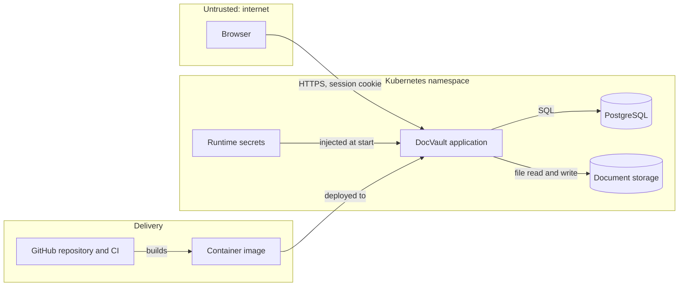

# DocVault threat model

Unauthorized access to confidential documents is DocVault's main risk, so access control, file handling and secret protection get the most attention.

This model uses STRIDE and maps to [OWASP Top 10:2025](https://github.com/OWASP/Top10/tree/master/2025/docs/en). It describes the planned design as of 2026-11-09. No application code exists yet, so exact code locations will be recorded in the vulnerability register when each flaw is built, before it is fixed.

Risk ratings are qualitative judgments, not measurements.

## System overview

Users sign in through a browser, then upload, search, download and share documents.

| Role | Can do | Cannot do |
| --- | --- | --- |
| Admin | Manage users and roles, read the audit log | Read other users' documents without being granted access |
| Member | Upload, search and download own documents, share them with other members | Reach admin pages or documents not shared with them |
| Auditor | Read the audit log | Read document contents or change anything |

## Assets

| ID | Asset | Why it matters |
| --- | --- | --- |
| AS1 | Uploaded documents | The confidential data DocVault exists to protect |
| AS2 | Password hashes and sessions | Allow impersonation of users |
| AS3 | Database password and session signing key | Give access to all data or allow forged sessions |
| AS4 | Roles and sharing records | Decide who can read what |
| AS5 | Audit log | Evidence for investigating incidents |
| AS6 | Repository, CI pipeline and images | A compromise here reaches production |

## Trust boundaries

| ID | Boundary | Crossing it |
| --- | --- | --- |
| TB1 | Browser to application | All user input is untrusted |
| TB2 | Application to database | Queries must not be built from raw input |
| TB3 | Application to document storage | File names and paths must not come from users |
| TB4 | CI to image and cluster | Only images that pass the security stage may be deployed |
| TB5 | Workload to Kubernetes | A compromised pod must not reach other pods or the Kubernetes API |

## STRIDE analysis

| ID | Category | Element | Threat | Risk | Planned control | Flaw |
| --- | --- | --- | --- | --- | --- | --- |
| T01 | Spoofing | Login | Password guessing or credential stuffing | Medium | Login rate limit, strong password hashing, failed-login logging | |
| T02 | Spoofing | Session | Session cookie stolen through script injection | High | `HttpOnly`, `Secure` and `SameSite` cookies; output encoding | F03 |
| T03 | Spoofing | Session | Hard-coded signing key lets an attacker forge sessions | High | Key supplied at runtime and rotated after exposure | F05 |
| T04 | Tampering | Database | SQL injection changes records or sharing rules | High | Parameterized queries | F02 |
| T05 | Tampering | Document storage | Crafted file name writes outside the storage folder | High | Server-generated storage names; path checks | F04 |
| T06 | Tampering | Dependencies and image | Vulnerable or compromised third-party component | High | Pinned versions, dependency and image scans | F06 |
| T07 | Tampering | CI pipeline | Workflow abused to alter a build | Medium | Read-only token, actions and images pinned by digest | |
| T08 | Repudiation | Sharing and deletion | User denies sharing or deleting a document | Medium | Audit log with user, action, time and correlation ID | |
| T09 | Information disclosure | Document download | Changing a document ID opens another user's file | High | Ownership or share check on every request | F01 |
| T10 | Information disclosure | Search | SQL injection extracts documents or password hashes | High | Parameterized queries, limited database account | F02 |
| T11 | Information disclosure | Document storage | Path traversal reads files outside the storage folder | High | Look up files by ID, never by user-supplied path | F04 |
| T12 | Information disclosure | Repository and image | Secret committed to Git or built into an image | High | Runtime secrets, secret scanning, revoke-then-purge procedure | F05 |
| T13 | Information disclosure | Logs | Passwords, tokens or document contents written to logs | Medium | Structured logs with an allowed list of fields | |
| T14 | Denial of service | Upload | Very large or repeated uploads fill storage | Medium | Upload size limit, per-user quota, resource limits | |
| T15 | Denial of service | Search and login | Expensive requests exhaust the application | Low | Rate limits and CPU and memory limits | |
| T16 | Elevation of privilege | Admin pages | Member reaches admin functions | High | Server-side role check on every admin route | |
| T17 | Elevation of privilege | Container | Root or privileged container helps an attacker escape | High | Non-root, read-only root filesystem, dropped capabilities | F07 |
| T18 | Elevation of privilege | Cluster | Compromised pod reaches other workloads or the Kubernetes API | High | No service account token, least-privilege access, default-deny network rules, admission policy | F07 |

## Planned initial flaws

The course requires at least four deliberate flaws. These seven are built, and their details are in the [vulnerability register](vulnerability-register.md). The detection column lists real Gitleaks, Semgrep and Trivy results. ZAP, the image scan, Checkov and Kyverno are still expected results until they run.

| ID | Flaw | CWE | OWASP 2025 | Proof of exploitation | Detection |
| --- | --- | --- | --- | --- | --- |
| F01 | A member can download another member's document by changing its ID | CWE-639 | A01 Broken Access Control | Two-user test script | Not reliably found by scanners; covered by automated tests |
| F02 | SQL injection in document search | CWE-89 | A05 Injection | Extract data through the search field | Semgrep; ZAP expected |
| F03 | Script injection through the search page and document titles | CWE-79 | A05 Injection | Script runs in the victim's browser | Missed by Semgrep; ZAP expected |
| F04 | Path traversal in file upload and download | CWE-22 | A01 Broken Access Control | Read a file outside the storage folder | Missed by Semgrep; ZAP expected |
| F05 | Session signing key hard-coded and committed (test value only) | CWE-798 | A07 Authentication Failures | Forge a session with the exposed key | Gitleaks |
| F06 | Dependency with a known critical vulnerability | CWE-1395 | A03 Software Supply Chain Failures | Show the CVE and affected use | Trivy |
| F07 | Container runs as root and the deployment is unrestricted | CWE-250 | A02 Security Misconfiguration | Show root access inside the pod; admission rejection after the fix | Semgrep; Checkov and Kyverno expected |

F02, F03 and F04 are the candidates for the two flaws that ZAP must confirm.

## OWASP Top 10:2025 coverage

| Category | Where it is addressed | Coverage |
| --- | --- | --- |
| A01 Broken Access Control | F01, F04, T16 | Planned flaw and tests |
| A02 Security Misconfiguration | F07, T18 | Planned flaw, Checkov and Kyverno |
| A03 Software Supply Chain Failures | F06, T06, T07 | Planned flaw and scans. Scanners only find known issues |
| A04 Cryptographic Failures | T01, T02 | Standard password hashing and HTTPS-only cookies. No planned flaw |
| A05 Injection | F02, F03 | Planned flaws, Semgrep and ZAP |
| A06 Insecure Design | This threat model, T14 | Design review only. No tool proves this |
| A07 Authentication Failures | F05, T01, T03 | Planned flaw and login controls |
| A08 Software or Data Integrity Failures | T06, T07 | Pinned images and actions. Image signing is not planned |
| A09 Security Logging and Alerting Failures | T08, T13 | Structured logs and one runtime detection |
| A10 Mishandling of Exceptional Conditions | T14, T15 | Error handling tests. No planned flaw |

## Out of scope

- Attacks on the developer's own workstation or on GitHub itself
- Attacks on the local Kubernetes node
- Malware inside uploaded documents, because DocVault stores files without opening them
